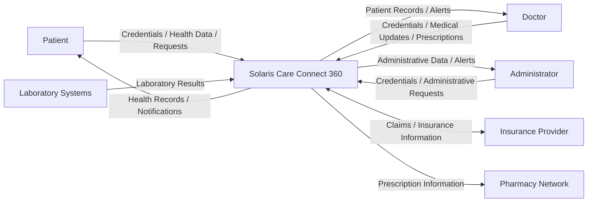

# Solaris Care Connect 360 – Data Flow Diagrams

## Overview

These Data Flow Diagrams (DFDs) show how information moves through Solaris Care Connect 360 and where sensitive data crosses trust boundaries.

The diagrams identify:

- external users and third-party systems
- application processes
- internal data stores
- authentication flows
- Protected Health Information (PHI)
- Personally Identifiable Information (PII)
- prescription and insurance information
- trust-boundary crossings

The DFDs are used as the basis for the STRIDE, risk and attack-scenario assessments.

---

# Level 0 – Context Diagram

The Level 0 DFD shows Solaris Care Connect 360 as a single system and identifies the external entities that exchange information with the platform.



---

## Level 0 External Entities

| External Entity | Interaction with Solaris Care Connect 360 |
|---|---|
| **Patient** | Authenticates, accesses health information, submits health data and sends messages |
| **Doctor** | Authenticates, accesses and updates patient information, creates prescriptions and communicates with patients |
| **Administrator** | Performs authorised administrative and privileged functions |
| **Insurance Provider** | Exchanges insurance verification and claims information |
| **Pharmacy Network** | Receives prescription information |
| **Laboratory Systems** | Supplies laboratory results to the healthcare platform |

---

# Level 1 – Detailed Data Flow

The Level 1 DFD expands Solaris Care Connect 360 into its major internal processes and data stores.

```mermaid
flowchart TB

    subgraph ExternalUsers["External Users"]
        Patient["Patient"]
        Doctor["Doctor"]
        Admin["Administrator"]
    end

    subgraph APILayer["Trust Boundary TB1 / API Layer"]
        API["API Gateway"]
        Auth["Authentication Service"]
    end

    subgraph Backend["Trust Boundary TB2 / Backend Services"]
        Records["Patient Records Service"]
        Rx["Prescription Service"]
        Messaging["Messaging Service"]
        Vitals["Vitals Monitoring"]
    end

    subgraph DataLayer["Trust Boundary TB3 / Data Stores"]
        PatientDB[("PostgreSQL Patient Database")]
        Documents[("Document Storage")]
        Cache[("Redis Cache")]
    end

    subgraph ExternalSystems["Trust Boundary TB4 / External Healthcare Systems"]
        Insurance["Insurance Provider APIs"]
        Pharmacy["Pharmacy Network"]
        Lab["Lab Results Feed"]
    end

    Patient -->|"Credentials / Requests / Health Data"| API
    Doctor -->|"Credentials / Medical Updates / Prescriptions"| API
    Admin -->|"Credentials / Administrative Requests"| API

    API -->|"Authentication Request"| Auth
    Auth -->|"Access Token / Session"| API

    API -->|"Authorised Patient Request"| Records
    Records -->|"Patient Records / Results"| API

    API -->|"Authorised Prescription Request"| Rx
    Rx -->|"Prescription Status"| API

    API -->|"Message Request"| Messaging
    Messaging -->|"Message Response"| API

    API -->|"Vitals Request"| Vitals
    Vitals -->|"Vitals Response"| API

    Records <-->|"Patient PHI / PII"| PatientDB
    Records <-->|"Medical Documents"| Documents

    Rx <-->|"Prescription Data"| PatientDB
    Rx -->|"Prescription Information"| Pharmacy

    Messaging <-->|"Session / Message Data"| Cache

    Lab -->|"Laboratory Results"| Vitals
    Vitals -->|"Vitals / Laboratory Data"| PatientDB

    Records <-->|"Claims / Insurance Verification"| Insurance

    API -->|"Authorised Response"| Patient
    API -->|"Authorised Response"| Doctor
    API -->|"Administrative Response"| Admin
```



---

# Key Data Flows

## DF1 – Authentication

```text
User → API Gateway → Authentication Service → API Gateway → User
```

### Data

- username / account identifier
- password or authentication credentials
- session or access token

### Security Requirements

- TLS encryption
- secure credential handling
- strong authentication
- secure session management
- authentication logging

---

## DF2 – Patient Record Access

```text
Patient / Doctor / Administrator
        ↓
    API Gateway
        ↓
Patient Records Service
        ↓
PostgreSQL Patient Database
```

### Data

- patient demographic information
- medical history
- clinical information
- health records

### Security Requirements

- authentication
- authorisation
- RBAC
- least privilege
- encryption
- audit logging

---

## DF3 – Prescription Processing

```text
Doctor
  ↓
API Gateway
  ↓
Prescription Service
  ↓
Patient Database
  ↓
Pharmacy Network
```

### Data

- patient identity
- medication
- dosage
- prescription information

### Security Requirements

- strong authorisation
- data integrity protection
- encryption
- audit logging
- authenticated external API communication

---

## DF4 – Laboratory Results

```text
Laboratory System
       ↓
Vitals Monitoring
       ↓
Patient Database
```

### Data

- patient identifiers
- laboratory test results
- clinical information

### Security Requirements

- authenticated data source
- encryption in transit
- integrity validation
- input validation
- audit logging

---

## DF5 – Insurance Exchange

```text
Patient Records Service ↔ Insurance Provider API
```

### Data

- patient identity
- insurance information
- claims information
- verification data

### Security Requirements

- authenticated API communication
- encryption
- minimum necessary data sharing
- monitoring and audit logging

---

# Sensitive Data Classification

| Data | Classification | Example Flow | Primary Security Requirement |
|---|---|---|---|
| Patient medical records | **PHI – Critical** | Database → Records Service → User | Confidentiality, integrity and availability |
| Laboratory results | **PHI – Critical** | Laboratory → Vitals → Database | Confidentiality and integrity |
| Prescription information | **PHI – Critical** | Doctor → Prescription Service → Pharmacy | Confidentiality and integrity |
| Patient identity information | **PII – High** | Database → Records Service | Confidentiality |
| Authentication credentials | **Sensitive – High** | User → Authentication Service | Confidentiality and integrity |
| Session / access tokens | **Sensitive – High** | Authentication Service → API Gateway | Confidentiality and integrity |
| Insurance information | **PII / Financial – High** | Records Service ↔ Insurance Provider | Confidentiality and integrity |
| Medical documents | **PHI – Critical** | Document Storage ↔ Records Service | Confidentiality and integrity |

---

# Trust Boundary Analysis

## TB1 – Internet → API Layer

### Crossing Flows

- patient authentication and requests
- doctor authentication and requests
- administrator authentication and privileged requests

### Primary Threats

- credential phishing
- account takeover
- injection attacks
- API abuse
- malicious input
- automated attacks

### Required Protections

- TLS
- strong authentication
- MFA
- request validation
- rate limiting
- WAF protection where appropriate
- authentication monitoring

---

## TB2 – API Layer → Backend Services

### Crossing Flows

- authorised patient-record requests
- prescription requests
- messaging requests
- administrative actions

### Primary Threats

- broken access control
- stolen token abuse
- privilege escalation
- unauthorised service access

### Required Protections

- service-level authorisation
- RBAC
- least privilege
- token validation
- security logging

---

## TB3 – Backend Services → Data Stores

### Crossing Flows

- patient PHI and PII
- prescriptions
- medical documents
- message/session data
- laboratory and vitals information

### Primary Threats

- SQL injection
- unauthorised database access
- excessive database privileges
- data modification
- bulk data extraction

### Required Protections

- parameterised database queries
- least-privilege service accounts
- encryption
- database activity monitoring
- audit logging
- secure storage configuration

---

## TB4 – Solaris → External Healthcare Systems

### Crossing Flows

- prescription information
- insurance information
- laboratory results

### Primary Threats

- third-party compromise
- malicious external data
- API authentication weakness
- interception
- excessive data disclosure

### Required Protections

- authenticated APIs
- TLS encryption
- input validation
- restricted data sharing
- third-party monitoring
- integration logging

---

# Threat-Modelling Relevance

The DFD identifies several important attack surfaces used throughout the threat model.

### Scenario 1 – Credential Phishing

The attacker crosses **TB1** by using stolen administrator credentials to authenticate through the legitimate API and Authentication Service.

### SQL Injection Scenario

Malicious input can enter through **TB1** and potentially propagate through **TB2** towards data stores across **TB3** if application input validation and database protections fail.

### External Integration Threats

Laboratory, pharmacy and insurance connections cross **TB4**, creating third-party trust relationships that require authentication, validation and monitoring.

### Insider Threat

A legitimate internal or privileged identity may already operate within one or more trust boundaries, making least privilege, auditing and behavioural monitoring particularly important.

---

# Key Security Observation

The most sensitive flows ultimately converge on the platform's healthcare data stores.

This means security must be enforced at multiple layers:

**external request → authentication → API authorisation → service authorisation → data-store permissions → monitoring and auditing**

A failure at one layer should therefore not automatically provide unrestricted access to PHI or PII.

---

## Related Documentation

**[High-Level Architecture](./HLD.md)**

**[Inherent Risk Assessment](./Inherent%20Risk%20Assessment.md)**

**[Scenario 1 – AI-Assisted Phishing and Credential Compromise](./Scenario%201/README.md)**
