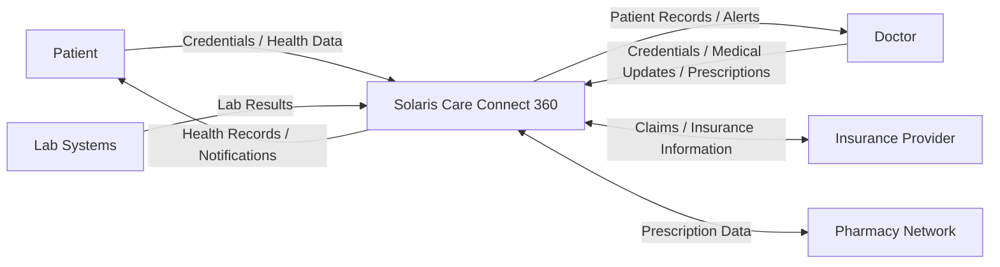
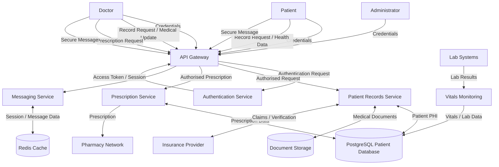

# Solaris Care Connect 360 - Data Flow Diagram

## Overview

This Data Flow Diagram (DFD) shows how sensitive information moves through Solaris Care Connect 360. It identifies external entities, application processes, data stores and the major flows of Protected Health Information (PHI), Personally Identifiable Information (PII) and authentication data.

## Level 0 - Context Diagram

### External Entities

- **Patient** - accesses personal health information and submits health data.
- **Doctor** - accesses and updates patient records and creates prescriptions.
- **Insurance Provider** - exchanges claims and insurance information.
- **Pharmacy Network** - receives and processes prescription information.
- **Lab Systems** - provides patient laboratory results.

---

## Level 1 - Detailed Data Flow

## Sensitive Data Flows

| Data | Classification | Example Flow | Protection Required |
|---|---|---|---|
| Patient medical records | PHI - Critical | Database → Records Service → Doctor | Encryption, authorisation, audit logging |
| Lab results | PHI - Critical | Lab → Vitals → Database | TLS, source validation, integrity checking |
| Prescription information | PHI - Critical | Doctor → Rx Service → Pharmacy | Encryption, authorisation, audit logging |
| Login credentials | PII - High | User → Authentication Service | TLS, secure password hashing, MFA |
| Session/access tokens | Sensitive | Authentication → API Gateway | Signed tokens, short expiry, secure storage |
| Insurance information | PII/Financial - High | Records Service ↔ Insurance | Encryption, authentication, audit logging |

## Trust Boundaries

The following flows cross important trust boundaries:

1. **Internet → API Gateway**
   - Patient, doctor and administrator requests enter the platform.

2. **API Gateway → Internal Services**
   - Authenticated requests move from the externally accessible API layer into trusted backend services.

3. **Backend Services → Data Stores**
   - Highly sensitive PHI and PII moves between application services and internal storage.

4. **Solaris → Third-Party Systems**
   - Healthcare information crosses organisational boundaries when communicating with laboratories, pharmacies and insurers.

Data crossing these boundaries should be authenticated, authorised, encrypted and validated where appropriate.
