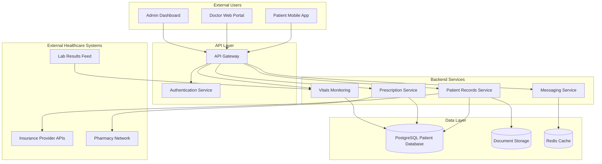

# Solaris Care Connect 360 – High-Level Architecture

## Overview

Solaris Care Connect 360 is an internet-facing healthcare platform that manages approximately **50,000 active patient records**.

The platform provides:

- patient health-record access
- doctor access to clinical information
- prescription management
- patient monitoring
- doctor-patient messaging
- administrative functionality
- integrations with external healthcare providers

The architecture below identifies the major system components, external entities, data stores, entry points and trust boundaries used throughout the threat-modelling assessment.

---

## System Components

| Layer | Components | Primary Function |
|---|---|---|
| **Frontend Applications** | Patient Mobile App, Doctor Web Portal, Admin Dashboard | User interaction with Solaris Care Connect 360 |
| **API Layer** | API Gateway, Authentication Service | Request routing, authentication and access into backend services |
| **Backend Services** | Patient Records Service, Prescription Service, Messaging Service, Vitals Monitoring | Processing healthcare and application functionality |
| **Data Layer** | PostgreSQL Patient Database, Document Storage, Redis Cache | Storage of patient, document and temporary application data |
| **External Systems** | Insurance Provider APIs, Pharmacy Network, Lab Results Feed | Exchange of healthcare information with third parties |

---

## High-Level Architecture

---

## Trust Boundaries

The architecture contains four primary trust boundaries.

### TB1 – Internet to API Layer

**Boundary:**

External users → API Gateway

The Patient Mobile App, Doctor Web Portal and Admin Dashboard communicate with the externally accessible application interface.

### Security Concerns

- credential theft
- account impersonation
- malicious requests
- injection attacks
- automated attacks
- unauthorised API access

Traffic crossing this boundary should be authenticated, encrypted and validated.

---

### TB2 – API Layer to Backend Services

**Boundary:**

API Gateway / Authentication Service → Internal application services

Requests that have entered through the external API layer are passed to internal backend services.

### Security Concerns

- broken authorisation
- forged or stolen access tokens
- excessive privileges
- unauthorised service access
- insufficient validation

Backend services should not rely solely on the API Gateway for security and should enforce appropriate authorisation controls.

---

### TB3 – Backend Services to Data Stores

**Boundary:**

Application services → PostgreSQL / Document Storage / Redis

This boundary protects the platform's most sensitive information.

### Security Concerns

- unauthorised PHI/PII access
- SQL injection
- excessive database privileges
- data modification
- bulk data extraction
- insecure storage

Access should be restricted according to least privilege and sensitive activity should be logged.

---

### TB4 – Solaris to External Healthcare Systems

**Boundary:**

Solaris Care Connect 360 → Insurance, Pharmacy and Laboratory systems

Sensitive information crosses organisational boundaries when Solaris exchanges data with external healthcare providers.

### Security Concerns

- third-party compromise
- API authentication weaknesses
- data interception
- malicious or malformed external data
- excessive information sharing

External connections should be authenticated, encrypted, validated and monitored.

---

## Security-Relevant Entry Points

| Entry Point | Source | Potential Threats |
|---|---|---|
| **Patient Mobile App** | Internet / Patient | Credential attacks, malicious requests, account takeover |
| **Doctor Web Portal** | Internet / Doctor | Credential compromise, unauthorised patient access |
| **Admin Dashboard** | Internet / Administrator | Privileged credential compromise, privilege abuse |
| **API Gateway** | External application traffic | Injection, API abuse, malformed requests |
| **Lab Results Feed** | External provider | Malicious or manipulated healthcare data |
| **Insurance Provider API** | External provider | Third-party compromise, unauthorised data exchange |
| **Pharmacy Network** | External provider | Prescription-data exposure or manipulation |

---

## Critical Assets

The threat model prioritises the protection of the following assets:

| Asset | Classification | Security Requirement |
|---|---|---|
| Patient medical records | **PHI – Critical** | Confidentiality, integrity and availability |
| Prescription information | **PHI – Critical** | Confidentiality and integrity |
| Laboratory results | **PHI – Critical** | Confidentiality and integrity |
| Patient identity information | **PII – High** | Confidentiality |
| Authentication credentials | **Sensitive – High** | Confidentiality and integrity |
| Session / access tokens | **Sensitive – High** | Confidentiality and integrity |
| Insurance information | **PII / Financial – High** | Confidentiality and integrity |
| Administrator identities | **Privileged – Critical** | Confidentiality and integrity |

---

## Primary Security Concerns

The architecture creates several high-value attack surfaces:

1. **Internet-facing authentication and APIs** may be targeted through phishing, credential abuse or application attacks.
2. **Privileged administrator identities** can provide significant access if compromised.
3. **Backend services and data stores** process highly sensitive PHI and PII.
4. **External healthcare integrations** introduce third-party trust relationships.
5. **Patient-record integrity** is critical because unauthorised modification could affect healthcare information.
6. **Service availability** is important because disruption could prevent legitimate users from accessing healthcare services.

These architectural characteristics form the basis for the STRIDE, MITRE ATT&CK, Cyber Kill Chain and risk analyses used throughout the threat model.

---

## Related Documentation

For detailed information flows and trust-boundary crossings, see:

**[Data Flow Diagram](./Data%20Flow%20Diagram.md)**

For the platform-wide inherent risk assessment, see:

**[Inherent Risk Assessment](./Inherent%20Risk%20Assessment.md)**

For the first detailed attack scenario, see:

**[Scenario 1 – AI-Assisted Phishing and Credential Compromise](./Scenario%201/README.md)**
