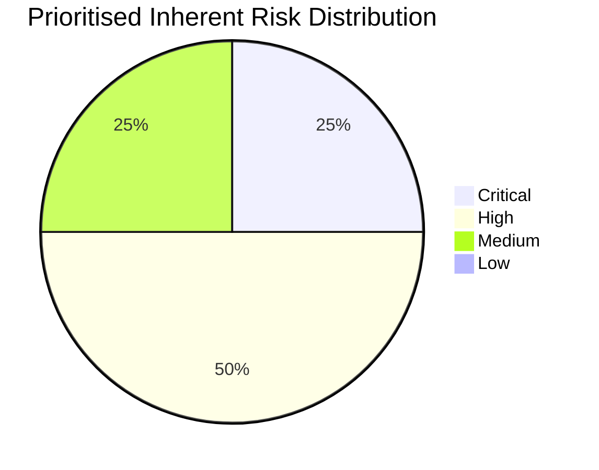

# Inherent Risk Assessment – Solaris Care Connect 360

## Overview

This document summarises the inherent security risk profile of Solaris Care Connect 360 before the effectiveness of proposed remediation controls is fully considered.

Solaris Care Connect 360 is a simulated healthcare platform managing approximately **50,000 active patient records** and processing sensitive information including:

- Protected Health Information (PHI)
- Personally Identifiable Information (PII)
- prescription information
- laboratory results
- authentication credentials
- insurance information

The detailed numerical assessment is maintained in the:

**[Risk Register](./templates/risk-register.md)**

---

# Risk Scoring Method

Risk is calculated using:

> **Risk Score = Likelihood × Impact**

Both Likelihood and Impact are scored from **1 to 5**.

| Score | Priority |
|---:|---|
| **16–25** | Critical |
| **10–15** | High |
| **5–9** | Medium |
| **1–4** | Low |

---

# Prioritised Inherent Risks

| ID | Risk | Likelihood | Impact | Score | Priority |
|---|---|---:|---:|---:|---|
| **I1** | SQL Injection – Patient Data Breach | 4 | 5 | **20** | 🔴 **Critical** |
| **S1** | Credential Phishing | 4 | 4 | **16** | 🔴 **Critical** |
| **E3** | SQL Injection to Database Administrator Access | 3 | 5 | **15** | 🟠 **High** |
| **I2** | Excessive API Data Return | 4 | 3 | **12** | 🟠 **High** |
| **E1** | Patient-to-Doctor Privilege Escalation | 3 | 4 | **12** | 🟠 **High** |
| **T2** | Prescription Tampering | 2 | 5 | **10** | 🟠 **High** |
| **D1** | DDoS Attack Against API Gateway | 3 | 3 | **9** | 🟡 **Medium** |
| **R1** | Prescription Approval Repudiation | 2 | 3 | **6** | 🟡 **Medium** |

---

# Risk Distribution

| Severity | Count |
|---|---:|
| 🔴 **Critical** | **2** |
| 🟠 **High** | **4** |
| 🟡 **Medium** | **2** |
| 🟢 **Low** | **0** |
| **Total** | **8** |



---

# Risk Matrix

| Likelihood ↓ / Impact → | 1 – Negligible | 2 – Minor | 3 – Moderate | 4 – Major | 5 – Severe |
|---|---:|---:|---:|---:|---:|
| **5 – Almost Certain** | 5 Medium | 10 High | 15 High | 20 Critical | 25 Critical |
| **4 – Likely** | 4 Low | 8 Medium | 12 High | 16 Critical | 20 Critical |
| **3 – Possible** | 3 Low | 6 Medium | 9 Medium | 12 High | 15 High |
| **2 – Unlikely** | 2 Low | 4 Low | 6 Medium | 8 Medium | 10 High |
| **1 – Rare** | 1 Low | 2 Low | 3 Low | 4 Low | 5 Medium |

---

# Critical Risks

## I1 – SQL Injection Data Breach

**Score:** 20/25 – Critical

A successful SQL injection vulnerability within the Patient Records Service or another internet-facing application component could allow unauthorised access to sensitive patient information.

### Primary Impact

- PHI / PII disclosure
- large-scale privacy breach
- regulatory consequences
- reputational damage

### Priority Controls

- parameterised queries
- input validation
- Web Application Firewall
- database least privilege
- Database Activity Monitoring

---

## S1 – Credential Phishing

**Score:** 16/25 – Critical

An attacker may obtain valid Solaris credentials through phishing and use the compromised identity to access legitimate application functionality.

### Primary Impact

- account takeover
- unauthorised patient-record access
- privileged access abuse
- potential PHI / PII disclosure

### Priority Controls

- phishing-resistant MFA
- security awareness training
- secure email filtering
- conditional access
- authentication anomaly detection

---

# High Risks

The High-risk group includes:

- **E3 – SQL Injection to DBA**
- **I2 – Excessive API Data Return**
- **E1 – Patient-to-Doctor Privilege Escalation**
- **T2 – Prescription Tampering**

These threats primarily affect:

- authorisation
- database security
- healthcare-data confidentiality
- healthcare-data integrity

High risks should be addressed following remediation of the Critical findings.

---

# Medium Risks

The Medium-risk group includes:

- **D1 – DDoS Against API Gateway**
- **R1 – Prescription Approval Repudiation**

These risks affect:

- service availability
- accountability
- auditability

They should be addressed through planned remediation and continued monitoring.

---

# Inherent vs Residual Risk

The scores in this assessment represent **inherent risk**.

```text
Inherent Risk
      ↓
Security Controls
      ↓
Control Effectiveness Testing
      ↓
Residual Risk
```

A risk should not be considered reduced simply because a control has been recommended.

Controls must first be:

1. implemented
2. configured correctly
3. tested for effectiveness
4. monitored over time

The risk can then be reassessed to determine the remaining **residual risk**.

---

# Key Finding

The current inherent-risk profile is dominated by two attack paths:

### Application Compromise

```text
Internet-Facing Application
        ↓
SQL Injection
        ↓
Database Access
        ↓
PHI / PII Exposure
```

### Identity Compromise

```text
Phishing
   ↓
Credential Theft
   ↓
Valid Account Abuse
   ↓
Patient Data Access
```

These two paths account for the **two Critical risks** identified in the prioritised assessment.

---

## Related Documentation

- [Complete Risk Register](./templates/risk-register.md)
- [STRIDE Threat Register](./templates/stride-threats.md)
- [Security Control Mapping](./templates/control-mapping.md)
- [MITRE ATT&CK Mapping](./templates/mitre-mapping.md)
- [System Architecture](./diagrams/architecture.md)
