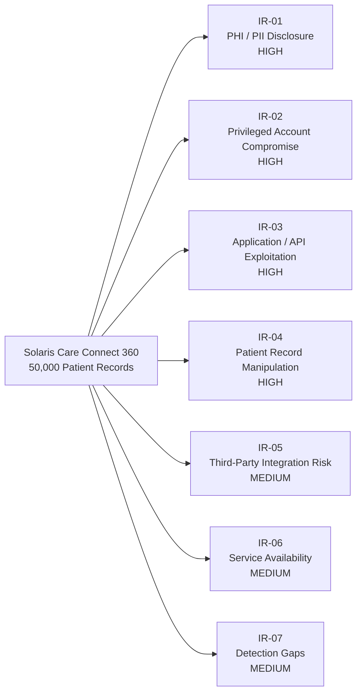

# Solaris Care Connect 360 – Inherent Risk Assessment

## Overview

This assessment identifies the inherent security risks associated with Solaris Care Connect 360 before considering the effectiveness of existing or proposed security controls.

Solaris Care Connect 360 is an internet-facing healthcare platform that manages approximately **50,000 active patient records** and processes sensitive Protected Health Information (PHI), Personally Identifiable Information (PII), authentication data and prescription information.

Because of the sensitivity of the information processed and the potential impact of unauthorised access or service disruption, several areas carry a significant inherent level of risk.

---

## Risk Assessment

| Risk ID | Risk Area | Risk Scenario | Likelihood | Impact | Inherent Risk |
|---|---|---|---|---|---|
| IR-01 | Sensitive Healthcare Data | Unauthorised access results in disclosure of patient PHI and PII | High | High | **High** |
| IR-02 | Privileged Account Compromise | Administrator or other privileged credentials are compromised and abused | High | High | **High** |
| IR-03 | Internet-Facing Application | Application or API vulnerabilities are exploited to gain unauthorised access | Medium | High | **High** |
| IR-04 | Patient Record Integrity | An attacker or malicious insider modifies clinical or patient information | Medium | High | **High** |
| IR-05 | Third-Party Integrations | Compromise or misuse of pharmacy, laboratory or insurance integrations exposes sensitive information | Medium | Medium | **Medium** |
| IR-06 | Service Availability | Denial-of-service or infrastructure failure prevents access to healthcare services | Medium | Medium | **Medium** |
| IR-07 | Monitoring and Detection | Malicious authenticated activity remains undetected long enough to increase the impact of an incident | Medium | Medium | **Medium** |

---

## Risk Rating Method

Risk is assessed using two factors:

- **Likelihood** – the probability that the threat could successfully occur.
- **Impact** – the potential effect on confidentiality, integrity, availability, patient privacy and business operations.

### Likelihood

| Rating | Description |
|---|---|
| **High** | The threat is credible and could reasonably occur against an internet-facing healthcare platform. |
| **Medium** | The threat is feasible but requires additional access, conditions or security failures. |
| **Low** | The threat requires unusual circumstances or multiple unlikely failures. |

### Impact

| Rating | Description |
|---|---|
| **High** | Significant PHI/PII exposure, privileged access, patient-safety implications, major operational disruption or regulatory consequences. |
| **Medium** | Limited data exposure, restricted compromise or recoverable operational disruption. |
| **Low** | Minimal effect on sensitive data or business operations. |

---

## Risk Matrix

| Likelihood ↓ / Impact → | Low | Medium | High |
|---|---|---|---|
| **High** | Medium | High | **High** |
| **Medium** | Low | **Medium** | **High** |
| **Low** | Low | Low | Medium |

---

## Inherent Risk Profile

---

## Key Observations

The assessment identified:

- **4 High inherent risks**
- **3 Medium inherent risks**
- **0 Low inherent risks**

The highest-risk areas relate to the confidentiality and integrity of patient information, privileged account compromise and exploitation of the externally accessible application and API layer.

The risk profile reflects the sensitivity of healthcare information, the scale of approximately 50,000 active patient records and the platform's reliance on privileged identities, internet-facing services and external healthcare integrations.

---

## Risk Treatment Approach

High risks should receive priority treatment through preventative and detective controls including:

1. Strong authentication and phishing-resistant MFA.
2. Role-based access control and least privilege.
3. Secure application development and vulnerability management.
4. Input validation and Web Application Firewall protection.
5. Encryption of PHI and PII in transit and at rest.
6. Centralised logging, SIEM monitoring and anomaly detection.
7. Secure integration controls for external healthcare providers.
8. Tested incident response, backup and recovery procedures.

Residual risk should be reassessed after the effectiveness of these controls has been evaluated.
