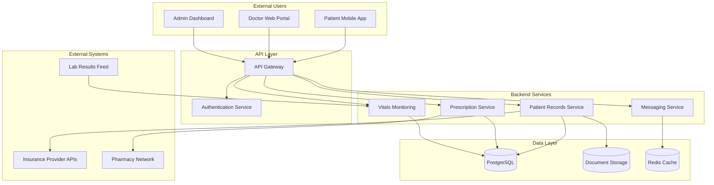
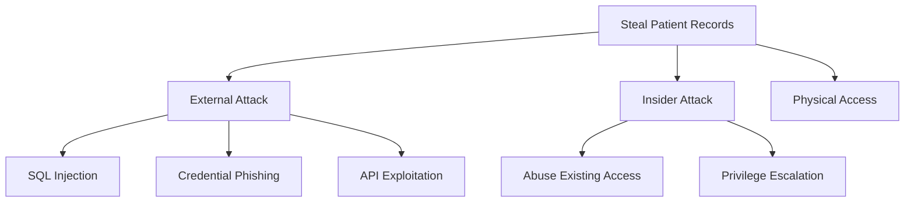

# Solaris Care Connect 360 – Healthcare Threat Model

A comprehensive threat-modelling assessment of a simulated healthcare platform supporting approximately **50,000 patient records**.

The project applies **STRIDE**, **MITRE ATT&CK**, the **Cyber Kill Chain**, quantitative risk scoring and **NIST CSF 2.0** control mapping to identify, prioritise and remediate security threats affecting sensitive healthcare data.

> **Portfolio Project:** This repository represents a simulated security architecture and threat-modelling exercise. No real patient data or production healthcare environment was assessed.

---

## Project Objectives

The assessment was designed to:

- identify security threats across the Solaris architecture
- map sensitive PHI and PII data flows
- identify trust boundaries and attack surfaces
- apply STRIDE threat categorisation
- map attacker behaviour to MITRE ATT&CK
- analyse attacks using the Cyber Kill Chain
- quantify risks using Likelihood × Impact scoring
- identify preventive, detective and corrective controls
- map remediation activities to NIST CSF 2.0
- produce a professional threat-model report

---

# System Overview

Solaris Care Connect 360 provides:

- Patient Mobile App
- Doctor Web Portal
- Admin Dashboard
- Patient Records Service
- Prescription Service
- Messaging Service
- real-time Vitals Monitoring
- PostgreSQL patient-data storage
- Document Storage
- Redis caching
- Insurance Provider integrations
- Pharmacy Network integration
- Laboratory Results integration

The system processes sensitive data including:

**PHI, PII, prescriptions, laboratory results, authentication credentials, session tokens and insurance information.**

---

# Architecture



Detailed architecture:

**[View System Architecture](./diagrams/architecture.md)**

---

# Threat-Modelling Methodology

The assessment combines several security frameworks.

| Framework | Purpose |
|---|---|
| **STRIDE** | Identify and categorise system threats |
| **MITRE ATT&CK** | Map threats to recognised adversary behaviours |
| **Cyber Kill Chain** | Analyse progression through an attack lifecycle |
| **Likelihood × Impact** | Quantitatively prioritise identified risks |
| **NIST CSF 2.0** | Structure recommended security controls and remediation |

---

# Key Findings

The complete STRIDE analysis identified **31 threats** across Solaris Care Connect 360.

Eight priority threats were selected for detailed numerical risk assessment.

| Severity | Count |
|---|---:|
| 🔴 **Critical** | **2** |
| 🟠 **High** | **4** |
| 🟡 **Medium** | **2** |
| 🟢 **Low** | **0** |

---

## Top Risks

| Rank | Risk | Score | Priority |
|---:|---|---:|---|
| **1** | SQL Injection – Patient Data Breach | **20/25** | 🔴 Critical |
| **2** | Credential Phishing | **16/25** | 🔴 Critical |
| **3** | SQL Injection to DBA Access | **15/25** | 🟠 High |
| **4** | Excessive API Data Return | **12/25** | 🟠 High |
| **5** | Patient-to-Doctor Privilege Escalation | **12/25** | 🟠 High |

The assessment identified two particularly important attack routes.

### Application Compromise

```text
Internet-Facing Application
        ↓
SQL Injection
        ↓
Database Access
        ↓
PHI / PII Exposure
```

### Identity Compromise

```text
Credential Phishing
        ↓
Credential Theft
        ↓
Valid Account Abuse
        ↓
Patient Record Access
```

**[View Full Risk Register](./templates/risk-register.md)**

---

# STRIDE Analysis

The platform-wide STRIDE assessment identified:

| STRIDE Category | Total | Critical | High | Medium | Low |
|---|---:|---:|---:|---:|---:|
| **Spoofing** | 5 | 2 | 2 | 1 | 0 |
| **Tampering** | 5 | 3 | 2 | 0 | 0 |
| **Repudiation** | 5 | 0 | 3 | 2 | 0 |
| **Information Disclosure** | 6 | 3 | 2 | 1 | 0 |
| **Denial of Service** | 5 | 0 | 3 | 2 | 0 |
| **Elevation of Privilege** | 5 | 4 | 1 | 0 | 0 |
| **Total** | **31** | **12** | **13** | **6** | **0** |

**[View Complete STRIDE Threat Register](./templates/stride-threats.md)**

---

# Attack Tree

The primary attacker objective assessed was:

> **Steal Patient Records**



The attack-tree analysis identified multiple routes to the same objective, demonstrating why Solaris requires defence in depth across identity, application security and access control.

**[View Attack Tree Analysis](./diagrams/attack-trees.md)**

---

# MITRE ATT&CK Coverage

Key techniques mapped during the assessment include:

| Technique | MITRE ID | Application |
|---|---|---|
| Spearphishing Link | **T1566.002** | Targeted credential phishing |
| Valid Accounts | **T1078** | Abuse of legitimate credentials |
| Steal Application Access Token | **T1528** | Session or token compromise |
| Exploit Public-Facing Application | **T1190** | Application exploitation and SQL injection |
| Trusted Relationship | **T1199** | Abuse of trusted external healthcare integrations |
| Adversary-in-the-Middle | **T1557** | Interception of external integration traffic |
| Create Account | **T1136** | Creation of unauthorised accounts for persistence |
| Account Manipulation | **T1098** | Modification of roles or account privileges |
| Indicator Removal | **T1070** | Removal or manipulation of security evidence |
| Escape to Host | **T1611** | Container breakout where applicable |
| Data from Information Repositories | **T1213** | Collection of stored sensitive information |
| Exfiltration Over Web Service | **T1567** | Potential transfer of collected data using a web service |

> Exfiltration techniques are only applicable when the corresponding data-transfer behaviour is explicitly present in an attack scenario.

**[View MITRE ATT&CK Mapping](./templates/mitre-mapping.md)**

---

# Cyber Kill Chain Analysis

The project analyses attacks across the seven Cyber Kill Chain stages:

```text
Reconnaissance
      ↓
Weaponization
      ↓
Delivery
      ↓
Exploitation
      ↓
Installation
      ↓
Command & Control
      ↓
Actions on Objectives
```

Both external ransomware activity and insider threats were assessed.

The analysis identifies detection and prevention opportunities including:

- email filtering
- endpoint detection
- patch management
- network monitoring
- Database Activity Monitoring
- Data Loss Prevention
- incident response
- backup and recovery

**[View Cyber Kill Chain Analysis](./templates/kill-chain-analysis.md)**

---

# Security Control Recommendations

The assessment identified controls across preventive, detective and corrective categories.

## Identity Security

- phishing-resistant Multi-Factor Authentication
- conditional access
- login anomaly detection
- Privileged Access Management
- security awareness training

## Application & Database Security

- parameterised SQL queries
- server-side input validation
- Web Application Firewall
- database least privilege
- Database Activity Monitoring
- vulnerability and patch management

## Access Control

- Role-Based Access Control
- object-level authorisation
- least privilege
- separation of duties
- regular access reviews

## Data Protection

- encryption in transit and at rest
- secure backup storage
- Data Loss Prevention
- data minimisation
- patient-record access monitoring

## Monitoring & Detection

- centralised logging
- SIEM
- User Behaviour Analytics
- authentication anomaly detection
- database monitoring
- tamper-resistant audit records

---

# NIST CSF 2.0 Control Mapping

Recommended controls were mapped to relevant NIST Cybersecurity Framework functions and categories.

The assessment covers:

**Identify → Protect → Detect → Respond → Recover**

Examples include:

| NIST CSF Area | Security Activities |
|---|---|
| **Identify** | Architecture analysis, asset identification, risk assessment |
| **Protect** | MFA, RBAC, encryption, secure development, awareness training |
| **Detect** | SIEM, anomaly detection, Database Activity Monitoring |
| **Respond** | Incident management, session revocation, investigation |
| **Recover** | Backups, restoration procedures, lessons learned |

**[View Security Control Mapping](./templates/control-mapping.md)**

---

# Remediation Roadmap

## 0–30 Days

- implement phishing-resistant MFA
- deploy WAF protection
- validate parameterised database queries
- restrict database service-account privileges
- begin phishing-awareness training

## 30–90 Days

- deploy Database Activity Monitoring
- complete RBAC and authorisation review
- implement authentication anomaly detection
- improve API data minimisation
- strengthen prescription audit trails
- implement DDoS protection and rate limiting

## 90–180 Days

- implement Privileged Access Management
- deploy User Behaviour Analytics
- mature Data Loss Prevention capabilities
- test incident-response procedures
- review backup and recovery controls
- establish recurring access reviews

---

# Detailed Scenario – AI-Assisted Phishing

A detailed attack scenario was developed to demonstrate how the frameworks can be applied to a specific attack path.

The scenario models:

```text
Target Research
      ↓
AI-Assisted Phishing
      ↓
Credential Capture
      ↓
Valid Account Authentication
      ↓
Privileged Access
      ↓
Patient Record Access
      ↓
Potential PHI / PII Disclosure
```

The Scenario 1 analysis includes:

- detailed attacker flow
- scenario-specific risk assessment
- STRIDE analysis
- MITRE ATT&CK mapping
- Cyber Kill Chain mapping
- preventive, detective and corrective controls

**[View Scenario 1 – AI-Assisted Phishing and Credential Compromise](./Scenario%201/README.md)**

---

# Repository Structure

```text
threatmodellingprojectagoge/
│
├── diagrams/
│   ├── architecture.md
│   ├── dfd-level0.md
│   ├── dfd-level1.md
│   └── attack-trees.md
│
├── templates/
│   ├── stride-threats.md
│   ├── mitre-mapping.md
│   ├── kill-chain-analysis.md
│   ├── risk-register.md
│   └── control-mapping.md
│
├── reports/
│   └── threat-model-report.md
│
├── Scenario 1/
│   ├── README.md
│   ├── Attacker Flow.md
│   ├── Risks Summary.md
│   ├── Controls Required.md
│   ├── STRIDE.md
│   └── MITRE ATT&CK Sequence Summary.md
│
├── HLD.md
├── Data Flow Diagram.md
├── Inherent Risk Assessment.md
└── README.md
```

---

# Project Documentation

| Document | Description |
|---|---|
| **[Threat Model Report](./reports/threat-model-report.md)** | Full executive and technical assessment |
| **[System Architecture](./diagrams/architecture.md)** | Components, entry points and trust boundaries |
| **[Level 0 DFD](./diagrams/dfd-level0.md)** | High-level external data flows |
| **[Level 1 DFD](./diagrams/dfd-level1.md)** | Detailed processes and sensitive-data flows |
| **[STRIDE Threat Register](./templates/stride-threats.md)** | Complete 31-threat STRIDE register |
| **[MITRE ATT&CK Mapping](./templates/mitre-mapping.md)** | ATT&CK technique mapping |
| **[Cyber Kill Chain](./templates/kill-chain-analysis.md)** | External and insider attack analysis |
| **[Risk Register](./templates/risk-register.md)** | Likelihood × Impact scoring |
| **[Control Mapping](./templates/control-mapping.md)** | NIST CSF 2.0 mapping and control-gap analysis |
| **[Attack Trees](./diagrams/attack-trees.md)** | Patient-data attack paths |
| **[Scenario 1](./Scenario%201/README.md)** | Detailed AI-assisted phishing scenario |

---

# Skills Demonstrated

This project demonstrates practical experience with:

- threat modelling
- security architecture analysis
- STRIDE
- MITRE ATT&CK
- Cyber Kill Chain
- risk assessment and prioritisation
- attack-tree development
- Data Flow Diagrams
- trust-boundary identification
- PHI / PII data classification
- security control mapping
- NIST CSF 2.0
- defence in depth
- security documentation
- communicating technical risk to stakeholders

---

# Conclusion

The Solaris Care Connect 360 threat model demonstrates that healthcare security requires controls across **identity, application security, authorisation, data protection, monitoring and incident response**.

The two highest-priority risks identified were:

**I1 – SQL Injection Data Breach: 20/25 – Critical**

and

**S1 – Credential Phishing: 16/25 – Critical**

These findings demonstrate two fundamentally different attack routes:

> **technical application compromise**

and

> **trusted identity compromise**

The recommended security strategy therefore combines preventive controls with strong detection, containment and recovery capabilities.

---

# Full Threat Model Report

For the complete assessment, risk scoring, control-gap analysis and remediation recommendations:

## **[Read the Full Threat Model Report →](./reports/threat-model-report.md)**

---

*This repository was created as a simulated cybersecurity threat-modelling project for educational and portfolio purposes. No real patient information or production healthcare environment was assessed.*
