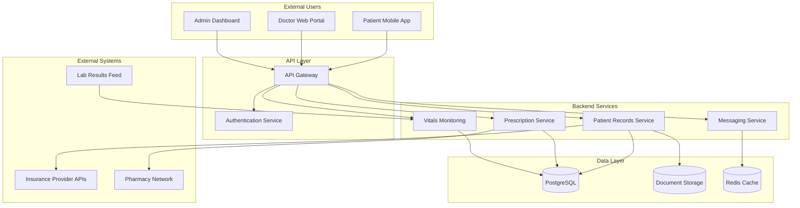
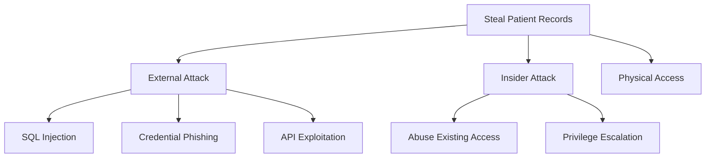

# Solaris Care Connect 360 – Healthcare Threat Model

A comprehensive threat-modelling assessment of a simulated healthcare platform supporting approximately **50,000 patient records**.

The project applies **STRIDE**, **MITRE ATT&CK**, the **Cyber Kill Chain**, quantitative risk scoring and **NIST CSF 2.0** control mapping to identify, prioritise and remediate security threats affecting sensitive healthcare data.

> **Portfolio Project:** This repository represents a simulated security architecture and threat-modelling exercise. No real patient data or production healthcare environment was assessed.

---

## Project Objectives

The assessment was designed to:

- identify security threats across the Solaris architecture
- map sensitive PHI and PII data flows
- identify trust boundaries and attack surfaces
- apply STRIDE threat categorisation
- map attacker behaviour to MITRE ATT&CK
- analyse attacks using the Cyber Kill Chain
- quantify risks using Likelihood × Impact scoring
- identify preventive, detective and corrective controls
- map remediation activities to NIST CSF 2.0
- produce a professional threat-model report

---

# System Overview

Solaris Care Connect 360 provides:

- Patient Mobile App
- Doctor Web Portal
- Admin Dashboard
- Patient Records Service
- Prescription Service
- Messaging Service
- real-time Vitals Monitoring
- PostgreSQL patient-data storage
- document storage
- Redis caching
- insurance integrations
- pharmacy integration
- laboratory-result integration

The system processes sensitive data including:

**PHI, PII, prescriptions, laboratory results, authentication credentials, session tokens and insurance information.**

---

## Architecture



Detailed architecture:

**[View System Architecture](./diagrams/architecture.md)**

---

# Threat-Modelling Methodology

The assessment combines several security frameworks.

| Framework | Purpose |
|---|---|
| **STRIDE** | Identify and categorise system threats |
| **MITRE ATT&CK** | Map threats to real-world attacker techniques |
| **Cyber Kill Chain** | Analyse progression through an attack lifecycle |
| **Likelihood × Impact** | Quantitatively prioritise identified risks |
| **NIST CSF 2.0** | Structure recommended security controls and remediation |

---

# Key Findings

The complete STRIDE analysis identified **31 threats** across the Solaris Care Connect 360 environment.

Eight priority threats were selected for detailed numerical risk assessment.

| Severity | Count |
|---|---:|
| 🔴 **Critical** | **2** |
| 🟠 **High** | **4** |
| 🟡 **Medium** | **2** |
| 🟢 **Low** | **0** |

---

## Top Risks

| Rank | Risk | Score | Priority |
|---:|---|---:|---|
| **1** | SQL Injection – Patient Data Breach | **20/25** | 🔴 Critical |
| **2** | Credential Phishing | **16/25** | 🔴 Critical |
| **3** | SQL Injection to DBA Access | **15/25** | 🟠 High |
| **4** | Excessive API Data Return | **12/25** | 🟠 High |
| **5** | Patient-to-Doctor Privilege Escalation | **12/25** | 🟠 High |

The assessment identified two particularly important attack routes:

```text
Application Compromise
        ↓
SQL Injection
        ↓
Database Access
        ↓
PHI / PII Exposure
```

and:

```text
Identity Compromise
        ↓
Credential Phishing
        ↓
Valid Account Abuse
        ↓
Patient Record Access
```

---

# Attack Tree

The primary attacker objective assessed was:

> **Steal Patient Records**



The full attack-tree analysis includes attack prerequisites, controls and detection opportunities:

**[View Attack Tree Analysis](./diagrams/attack-trees.md)**

---

# MITRE ATT&CK Coverage

Key techniques mapped during the assessment include:

| Technique | MITRE ID |
|---|---|
| Spearphishing Link | **T1566.002** |
| Valid Accounts | **T1078** |
| Steal Application Access Token | **T1528** |
| Exploit Public-Facing Application | **T1190** |
| Create Account | **T1136** |
| Account Manipulation | **T1098** |
| Escape to Host | **T1611** |
| Data from Information Repositories | **T1213** |
| Exfiltration Over Web Service | **T1567** |

**[View MITRE ATT&CK Mapping](./templates/mitre-mapping.md)**

---

# Security Control Recommendations

The highest-priority controls identified were:

### Identity Security

- phishing-resistant Multi-Factor Authentication
- conditional access
- login anomaly detection
- Privileged Access Management
- security awareness training

### Application & Database Security

- parameterised SQL queries
- server-side input validation
- Web Application Firewall
- database least privilege
- Database Activity Monitoring

### Access Control

- Role-Based Access Control
- object-level authorisation
- least privilege
- regular access reviews

### Monitoring & Detection

- centralised logging
- SIEM
- User Behaviour Analytics
- patient-record access monitoring
- Data Loss Prevention

---

# Remediation Roadmap

### 0–30 Days

- implement phishing-resistant MFA
- deploy WAF protection
- validate parameterised database queries
- restrict database service-account privileges
- begin phishing-awareness training

### 30–90 Days

- deploy Database Activity Monitoring
- complete RBAC review
- implement authentication anomaly detection
- improve API data minimisation
- implement DDoS protection

### 90–180 Days

- implement Privileged Access Management
- deploy User Behaviour Analytics
- mature Data Loss Prevention
- test incident-response procedures
- review backup and recovery controls

---

# Repository Structure

```text
threatmodellingprojectagoge/
│
├── diagrams/
│   ├── architecture.md
│   ├── dfd-level0.md
│   ├── dfd-level1.md
│   └── attack-trees.md
│
├── templates/
│   ├── stride-threats.md
│   ├── mitre-mapping.md
│   ├── kill-chain-analysis.md
│   ├── risk-register.md
│   └── control-mapping.md
│
├── reports/
│   └── threat-model-report.md
│
├── Scenario 1/
│   ├── README.md
│   ├── Attacker Flow.md
│   ├── Risks Summary.md
│   ├── Controls Required.md
│   ├── STRIDE.md
│   └── MITRE ATT&CK Sequence Summary.md
│
├── HLD.md
├── Data Flow Diagram.md
├── Inherent Risk Assessment.md
└── README.md
```

---

# Project Documentation

| Document | Description |
|---|---|
| **[Threat Model Report](./reports/threat-model-report.md)** | Full executive and technical assessment |
| **[System Architecture](./diagrams/architecture.md)** | Components, entry points and trust boundaries |
| **[Level 0 DFD](./diagrams/dfd-level0.md)** | High-level external data flows |
| **[Level 1 DFD](./diagrams/dfd-level1.md)** | Detailed processes and sensitive-data flows |
| **[STRIDE Threat Register](./templates/stride-threats.md)** | Complete 31-threat STRIDE register |
| **[MITRE ATT&CK Mapping](./templates/mitre-mapping.md)** | ATT&CK technique mapping |
| **[Cyber Kill Chain](./templates/kill-chain-analysis.md)** | External and insider attack analysis |
| **[Risk Register](./templates/risk-register.md)** | Likelihood × Impact scoring |
| **[Control Mapping](./templates/control-mapping.md)** | NIST CSF 2.0 mapping and control-gap analysis |
| **[Attack Trees](./diagrams/attack-trees.md)** | Patient-data attack paths |
| **[Scenario 1](./Scenario%201/README.md)** | Detailed AI-assisted phishing scenario |

---

# Skills Demonstrated

This project demonstrates practical experience with:

- threat modelling
- security architecture analysis
- STRIDE
- MITRE ATT&CK
- Cyber Kill Chain
- risk assessment and prioritisation
- attack-tree development
- data-flow analysis
- trust-boundary identification
- security control mapping
- NIST CSF 2.0
- defence in depth
- security documentation
- communicating technical risk to stakeholders

---

# Conclusion

The threat model demonstrates that protecting healthcare information requires controls across **identity, application security, authorisation, data protection, monitoring and incident response**.

The highest-priority findings were **SQL injection leading to patient-data exposure** and **credential phishing leading to valid-account compromise**.

The recommended security strategy therefore focuses on preventing these initial attack paths while maintaining sufficient detective and corrective controls to limit the impact of a successful compromise.

---

## Full Report

For the complete analysis, risk scoring and remediation recommendations:

### **[Read the Full Threat Model Report →](./reports/threat-model-report.md)**

---

*This repository was created as a simulated cybersecurity threat-modelling project for educational and portfolio purposes.*
