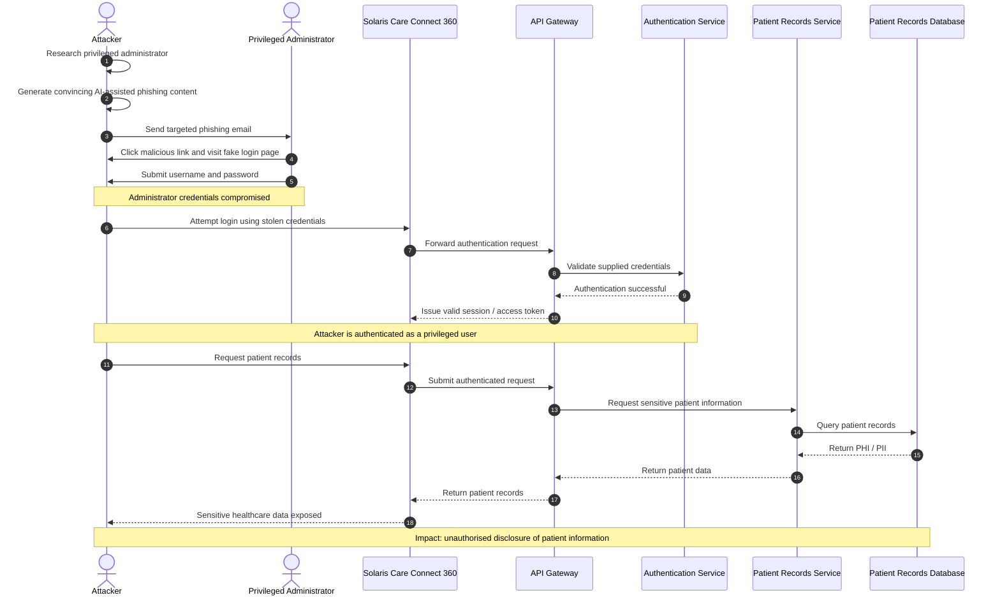

# Scenario 1 – AI-Assisted Phishing and Credential Compromise

## Attack Overview

This scenario models an attacker using AI-assisted social engineering to create a convincing phishing campaign targeting a privileged administrator of the Solaris Care Connect 360 healthcare platform.

The objective is to obtain valid administrator credentials, authenticate to the platform as a legitimate user, and gain unauthorised access to sensitive patient information.

## Attacker Flow

## Security Impact

A successful attack could result in:

- Compromise of a privileged administrator account.
- Unauthorised access to patient records.
- Exposure of personally identifiable information (PII) and protected health information (PHI).
- Abuse of a trusted authenticated session.
- Regulatory and reputational consequences.
- Potential follow-on attacks using the compromised account.

## Key Security Concerns

The scenario highlights the importance of:

- Multi-factor authentication (MFA).
- Phishing-resistant authentication.
- Role-based access control (RBAC).
- Least privilege.
- Login anomaly detection.
- Centralised audit logging.
- Security awareness training.
- Session monitoring and revocation.
