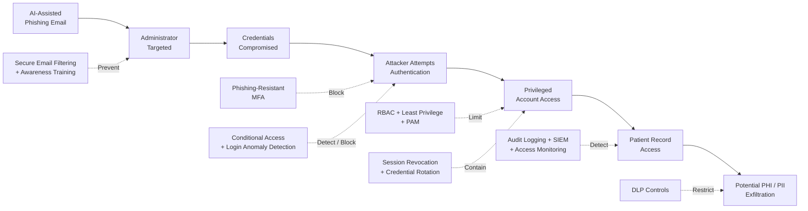

# Scenario 1 – Required Security Controls

## Overview

Scenario 1 models an **AI-assisted phishing attack resulting in the compromise of a privileged administrator account** within Solaris Care Connect 360.

The security controls below are designed to reduce the likelihood of successful credential compromise, prevent the misuse of stolen credentials, restrict the impact of a compromised account and detect suspicious access to sensitive patient information.

The controls are grouped into:

- **Preventive controls** – reduce the likelihood of compromise.
- **Detective controls** – identify suspicious or malicious activity.
- **Corrective controls** – contain and recover from an incident.

---

## Control Mapping

| Control ID | Security Control | Control Type | Primary Purpose | Risks Addressed |
|---|---|---|---|---|
| C1 | Phishing-resistant Multi-Factor Authentication (MFA) | Preventive | Prevent stolen passwords alone from providing account access | R1, R2 |
| C2 | Secure Email Filtering | Preventive | Identify and block malicious links, attachments and phishing messages | R1 |
| C3 | Security Awareness Training | Preventive | Improve administrator recognition and reporting of phishing attempts | R1 |
| C4 | Conditional Access | Preventive / Detective | Restrict authentication based on device, location and risk indicators | R2 |
| C5 | Role-Based Access Control (RBAC) | Preventive | Restrict users to permissions required for their role | R3 |
| C6 | Least Privilege | Preventive | Reduce the impact of a compromised privileged account | R3 |
| C7 | Privileged Access Management (PAM) | Preventive / Detective | Apply additional protection and monitoring to administrative access | R2, R3 |
| C8 | Login Anomaly Detection | Detective | Detect unusual authentication behaviour and possible account compromise | R2, R4 |
| C9 | Centralised Audit Logging and SIEM | Detective | Correlate authentication, privilege and data-access events | R4, R5 |
| C10 | Patient Record Access Monitoring | Detective | Detect unusual or excessive access to PHI and PII | R5 |
| C11 | Data Loss Prevention (DLP) | Preventive / Detective | Reduce unauthorised extraction of sensitive patient information | R5 |
| C12 | Session Revocation and Credential Rotation | Corrective | Terminate compromised sessions and invalidate stolen credentials | R2, R4, R5 |

---

# Preventive Controls

## C1 – Phishing-Resistant Multi-Factor Authentication

Privileged administrator accounts should require strong MFA.

Where possible, phishing-resistant methods such as:

- FIDO2 security keys
- passkeys
- certificate-based authentication

should be preferred over authentication methods that can be easily socially engineered.

### Security Benefit

Even if an attacker obtains the administrator's username and password through phishing, possession of those credentials alone should not be sufficient to authenticate.

**Primary risks reduced:** R1, R2.

---

## C2 – Secure Email Filtering

Email security controls should inspect incoming messages for:

- malicious URLs
- suspicious domains
- spoofed sender addresses
- malicious attachments
- known phishing indicators

Links may also be rewritten or inspected before users are permitted to access them.

### Security Benefit

Reduces the probability that the phishing email reaches or successfully deceives the administrator.

**Primary risk reduced:** R1.

---

## C3 – Security Awareness Training

Administrators and other privileged users should receive regular training covering:

- phishing indicators
- AI-generated social engineering
- suspicious login pages
- credential harvesting
- malicious attachments
- reporting procedures

Simulated phishing exercises can be used to reinforce awareness.

### Security Benefit

Reduces the likelihood that a privileged user provides credentials to an attacker.

**Primary risk reduced:** R1.

---

## C4 – Conditional Access

Authentication decisions should consider contextual information such as:

- source IP address
- geographic location
- device compliance
- authentication risk
- unusual login time
- impossible travel
- previously unseen devices

High-risk authentication attempts should require additional verification or be blocked.

### Security Benefit

A stolen password may still be rejected when the attacker's login behaviour differs significantly from the legitimate administrator.

**Primary risk reduced:** R2.

---

## C5 – Role-Based Access Control

Solaris Care Connect 360 should assign permissions according to defined job responsibilities.

Administrative privileges should not automatically provide unrestricted access to all patient information unless required by the administrator's role.

### Security Benefit

Limits the amount of sensitive data that can be accessed using a compromised identity.

**Primary risk reduced:** R3.

---

## C6 – Least Privilege

Users, administrators and services should receive only the permissions required to perform their authorised functions.

Privileged access should be separated from ordinary user activity where possible.

### Security Benefit

Reduces the potential blast radius if an administrator account is compromised.

**Primary risk reduced:** R3.

---

## C7 – Privileged Access Management

Administrative accounts should receive additional controls such as:

- dedicated privileged identities
- just-in-time administrative access
- approval for highly sensitive operations
- time-limited elevated privileges
- privileged-session auditing

### Security Benefit

Reduces persistent administrative privilege and improves accountability for sensitive actions.

**Primary risks reduced:** R2, R3.

---

# Detective Controls

## C8 – Login Anomaly Detection

Authentication activity should be monitored for indicators including:

- unusual source locations
- new devices
- repeated failed logins
- unusual authentication times
- impossible travel
- sudden changes in administrator behaviour

High-risk events should generate security alerts.

### Security Benefit

Helps identify stolen credentials being used by an attacker.

**Primary risks reduced:** R2, R4.

---

## C9 – Centralised Logging and SIEM Monitoring

Security-relevant logs should be collected centrally from:

- API Gateway
- Authentication Service
- administrative actions
- Patient Records Service
- database access
- external integrations

A SIEM platform should correlate these events and generate alerts for suspicious behaviour.

### Security Benefit

Provides visibility across the attack path and supports investigation and incident response.

**Primary risks reduced:** R4, R5.

---

## C10 – Patient Record Access Monitoring

The platform should identify unusual access patterns such as:

- bulk patient-record retrieval
- access outside normal working hours
- unusually high numbers of patient searches
- access inconsistent with the user's role
- repeated access to unrelated patient records

### Security Benefit

Allows suspicious activity to be detected even when the attacker is using a valid authenticated account.

**Primary risk reduced:** R5.

---

## C11 – Data Loss Prevention

DLP controls should monitor and restrict inappropriate movement of sensitive information.

Controls may include:

- export restrictions
- download limits
- detection of bulk PHI extraction
- restrictions on copying sensitive information
- alerts for unusual data transfers

### Security Benefit

Reduces the ability of a compromised administrator account to exfiltrate large volumes of PHI or PII.

**Primary risk reduced:** R5.

---

# Corrective Controls

## C12 – Session Revocation and Credential Rotation

When account compromise is suspected:

1. Active sessions should be revoked.
2. The affected account should be temporarily disabled where appropriate.
3. Credentials should be reset.
4. Authentication tokens should be invalidated.
5. MFA credentials should be reviewed or re-enrolled.
6. Recent privileged activity should be investigated.
7. Relevant patient-record access should be reviewed.

### Security Benefit

Limits the duration and impact of a successful credential-compromise incident.

**Primary risks reduced:** R2, R4, R5.

---

# Defence-in-Depth Control Flow

---

# Control Priorities

Controls should be implemented in the following order of priority:

| Priority | Controls | Reason |
|---|---|---|
| **P1 – Critical** | Phishing-resistant MFA, RBAC, least privilege | Directly prevents or limits the central attack path |
| **P1 – Critical** | Login anomaly detection and centralised audit logging | Enables rapid detection of stolen-account activity |
| **P2 – High** | Conditional access and privileged access management | Strengthens protection of privileged identities |
| **P2 – High** | Patient-record access monitoring and DLP | Limits and detects PHI/PII exposure |
| **P2 – High** | Secure email filtering and awareness training | Reduces likelihood of successful phishing |
| **P1 – Incident Response** | Session revocation and credential rotation | Rapidly contains a confirmed compromise |

---

## Expected Security Outcome

The objective is not to rely on a single security measure.

Instead, Solaris Care Connect 360 should apply **defence in depth** so that:

**phishing is harder to deliver → credential theft is harder to exploit → privileged access is restricted → suspicious behaviour is detected → patient-data exfiltration is limited → compromised accounts can be rapidly contained.**
