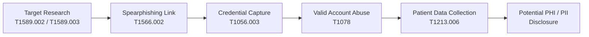
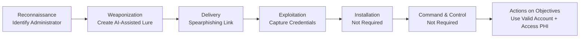

# Scenario 1 – MITRE ATT&CK Sequence Summary

## Scenario Overview

This assessment maps the **AI-assisted phishing and privileged credential compromise** scenario against the MITRE ATT&CK framework and the Cyber Kill Chain.

The attacker targets a privileged administrator of Solaris Care Connect 360 with a convincing phishing email containing a link to a fraudulent authentication page.

If successful, the attacker captures valid administrator credentials, authenticates to Solaris Care Connect 360 using the compromised identity and accesses sensitive patient information.

AI is used to improve the quality and credibility of the phishing lure, but the underlying attacker behaviours are mapped to established MITRE ATT&CK techniques.

---

# MITRE ATT&CK Mapping

| Attack Stage | MITRE Tactic | Technique | Technique ID | Application to Scenario 1 |
|---|---|---|---|---|
| Target Research | Reconnaissance | Gather Victim Identity Information: Email Addresses / Employee Names | **T1589.002 / T1589.003** | The attacker identifies a privileged administrator and obtains information needed to create a targeted phishing message |
| Phishing Delivery | Initial Access | Spearphishing Link | **T1566.002** | The administrator receives a convincing phishing email containing a malicious link |
| Credential Capture | Credential Access / Collection | Input Capture: Web Portal Capture | **T1056.003** | The fraudulent login page captures credentials entered by the administrator |
| Account Abuse | Initial Access / Persistence / Privilege Escalation / Defense Evasion | Valid Accounts | **T1078** | The attacker authenticates using the administrator's legitimate credentials |
| Data Collection | Collection | Data from Information Repositories: Databases | **T1213.006** | The authenticated attacker accesses sensitive patient information stored within the platform's patient database |

---

# ATT&CK Sequence

---

# Technique Analysis

## T1589.002 / T1589.003 – Gather Victim Identity Information

### Tactic
**Reconnaissance**

Before launching the phishing campaign, the attacker researches potential privileged users within Solaris Care Connect 360.

Information of interest may include:

- administrator names
- corporate email addresses
- job roles
- organisational responsibilities
- publicly available professional information

This information allows the attacker to create a more convincing and targeted social-engineering message.

### Scenario Application

The attacker specifically identifies a **privileged administrator** because compromising this identity could provide greater access to sensitive healthcare information.

### Defensive Measures

- Limit unnecessary public exposure of employee information.
- Monitor for impersonation of organisational identities.
- Security awareness training.
- Email security controls.

---

## T1566.002 – Phishing: Spearphishing Link

### Tactic
**Initial Access**

The attacker sends a targeted phishing email containing a link designed to appear legitimate.

AI-assisted content generation may be used to:

- improve grammar and presentation
- imitate trusted communication styles
- personalise the message
- create convincing business context
- increase the likelihood that the administrator interacts with the message

### Scenario Application

The privileged administrator receives the malicious email and follows the link to a fraudulent login page.

### Defensive Measures

- Secure email filtering.
- URL reputation analysis.
- Domain protection and anti-spoofing controls.
- Security awareness training.
- Phishing simulations.

---

## T1056.003 – Input Capture: Web Portal Capture

### Tactics
**Credential Access / Collection**

The phishing link directs the administrator to a fraudulent authentication portal designed to imitate Solaris Care Connect 360 or another trusted authentication service.

The administrator enters their username and password into the fraudulent page.

The attacker captures these credentials.

### Scenario Application

This technique represents the transition between the phishing attack and the subsequent compromise of the administrator identity.

### Defensive Measures

- Phishing-resistant MFA.
- Password managers that validate legitimate domains.
- Domain monitoring.
- User awareness training.
- Conditional access controls.

---

## T1078 – Valid Accounts

### Tactics
**Initial Access / Persistence / Privilege Escalation / Defense Evasion**

The attacker uses the stolen administrator credentials to authenticate through the legitimate Solaris Care Connect 360 login workflow.

This is particularly significant because the attacker is no longer attempting to exploit the application directly.

Instead, they are using a **trusted identity**.

### Scenario Application

The attacker:

1. Connects to Solaris Care Connect 360.
2. Submits the stolen administrator credentials.
3. Passes authentication if additional controls do not prevent access.
4. Receives a legitimate authenticated session.
5. Uses the privileges assigned to the administrator account.

### Defensive Measures

- Phishing-resistant MFA.
- Conditional access.
- Login anomaly detection.
- Privileged Access Management.
- Session monitoring.
- Credential rotation.

---

## T1213.006 – Data from Information Repositories: Databases

### Tactic
**Collection**

After successfully authenticating, the attacker uses the compromised privileged identity to access sensitive patient information.

Solaris Care Connect 360 stores patient information within a PostgreSQL patient database accessed through the Patient Records Service.

Potentially exposed information may include:

- personally identifiable information (PII)
- protected health information (PHI)
- medical histories
- prescriptions
- laboratory results
- patient demographic information

### Scenario Application

The attacker does not need to directly compromise PostgreSQL.

Instead, the legitimate application workflow may retrieve the information on behalf of the compromised authenticated user.

### Defensive Measures

- RBAC.
- Least privilege.
- Patient-record access monitoring.
- Database auditing.
- Data Loss Prevention.
- Encryption.
- SIEM alerting for unusual access patterns.

---

# Exfiltration Consideration

The scenario identifies **potential disclosure or exfiltration of patient information** as an attack objective.

However, a specific exfiltration method has not been defined.

For this reason, an additional MITRE ATT&CK exfiltration technique is **not assigned** in this scenario.

A technique such as Exfiltration Over Web Service should only be added if the scenario explicitly defines how the attacker transfers the collected patient information outside Solaris Care Connect 360.

This avoids mapping techniques that are not supported by the modelled attack path.

---

# Cyber Kill Chain Mapping

The original threat-modelling methodology requires the scenario to also be assessed against the Cyber Kill Chain.

Not every Kill Chain phase requires malware or command-and-control infrastructure. Because Scenario 1 primarily abuses a valid account, some traditional malware-focused stages are not required.

| Cyber Kill Chain Phase | Scenario 1 Activity | Relevant ATT&CK Technique |
|---|---|---|
| **Reconnaissance** | Identify privileged administrator, email address and role | T1589.002 / T1589.003 |
| **Weaponization** | Create AI-assisted phishing content and fraudulent login page | Supporting attacker preparation |
| **Delivery** | Send targeted phishing email containing malicious link | T1566.002 |
| **Exploitation** | Social engineering causes administrator to submit credentials | T1056.003 |
| **Installation** | **Not required** – no malware installation is necessary | N/A |
| **Command & Control** | **Not required** – attacker uses legitimate application access rather than a malware C2 channel | N/A |
| **Actions on Objectives** | Authenticate with stolen credentials and access patient information | T1078, T1213.006 |

---

# Kill Chain Visualisation

---

# Detection Opportunities

| Attack Behaviour | Detection Opportunity |
|---|---|
| Targeted phishing email | Email-security alerts, URL reputation and anti-spoofing controls |
| Administrator visits fraudulent authentication page | Secure web gateway and domain-reputation monitoring |
| Stolen credentials used from unusual source | Login anomaly detection and conditional access |
| New or unusual administrator session | Authentication logs and SIEM correlation |
| Excessive patient-record access | Patient-access auditing and behavioural analytics |
| Bulk PHI/PII retrieval | DLP and data-access monitoring |

---

# MITRE ATT&CK Summary

Scenario 1 demonstrates an identity-focused attack path:

**Reconnaissance → Spearphishing → Credential Capture → Valid Account Abuse → Patient Data Collection**

The most important security observation is that, after credential compromise, the attacker may interact with Solaris Care Connect 360 through **legitimate authentication and application functionality**.

The defensive strategy must therefore extend beyond perimeter security and focus on:

- phishing-resistant authentication
- identity monitoring
- least privilege
- privileged access management
- patient-data access monitoring
- reliable security logging

This mapping should be reviewed whenever the attack scenario changes. Additional ATT&CK techniques should only be added when the associated attacker behaviour is explicitly represented in the threat model.
