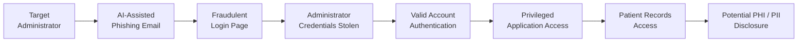

# Scenario 1 – AI-Assisted Phishing and Credential Compromise

## Overview

This scenario models an **AI-assisted phishing attack targeting a privileged administrator** of Solaris Care Connect 360.

The attacker uses publicly available information to identify a privileged user and creates a convincing phishing message containing a link to a fraudulent authentication page.

If the administrator submits their credentials, the attacker attempts to authenticate to Solaris Care Connect 360 using the stolen identity and access sensitive patient information through legitimate application functionality.

---

## Attack Objective

The attacker's primary objectives are to:

- compromise a privileged administrator identity
- authenticate using valid credentials
- gain access to privileged application functionality
- access sensitive patient information
- potentially disclose or exfiltrate PHI and PII

---

## Target Assets

The primary assets affected by this scenario are:

| Asset | Security Concern |
|---|---|
| Administrator credentials | Identity compromise and impersonation |
| Authentication Service | Abuse of legitimate authentication mechanisms |
| Privileged administrator account | Unauthorised privileged access |
| Patient Records Service | Unauthorised access to healthcare information |
| PostgreSQL patient database | Exposure or modification of sensitive patient data |
| PHI / PII | Confidentiality and privacy breach |
| Audit records | Detection, attribution and investigation |

---

## Attack Path

The detailed sequence of attacker and system interactions is documented in:

**[Attacker Flow](./Attacker%20Flow.md)**

---

## STRIDE Analysis

The scenario was assessed using the STRIDE threat-modelling framework.

| STRIDE Category | Scenario 1 Threat | Priority |
|---|---|---|
| **Spoofing** | Attacker impersonates a privileged administrator using stolen credentials | Critical |
| **Tampering** | Compromised account may modify sensitive patient information | High |
| **Repudiation** | Actions performed through a legitimate account may be difficult to attribute | High |
| **Information Disclosure** | Attacker accesses sensitive PHI and PII | Critical |
| **Denial of Service** | Privileged functionality could potentially be abused to disrupt services | Medium |
| **Elevation of Privilege** | Attacker attempts to gain permissions beyond the compromised account | High |

The complete assessment is available in:

**[STRIDE Threat Analysis](./STRIDE.md)**

---

## MITRE ATT&CK Mapping

The principal MITRE ATT&CK techniques associated with the attack path are:

| Technique | ID | Application |
|---|---|---|
| Gather Victim Identity Information | **T1589.002 / T1589.003** | Identify administrator email address and identity |
| Spearphishing Link | **T1566.002** | Deliver targeted phishing link |
| Input Capture: Web Portal Capture | **T1056.003** | Capture credentials through fraudulent login portal |
| Valid Accounts | **T1078** | Authenticate using compromised administrator credentials |
| Data from Information Repositories: Databases | **T1213.006** | Access patient information through the compromised identity |

The complete MITRE ATT&CK and Cyber Kill Chain mapping is available in:

**[MITRE ATT&CK Sequence Summary](./MITRE%20ATT%26CK%20Sequence%20Summary.md)**

---

## Cyber Kill Chain

Scenario 1 maps to the Cyber Kill Chain as follows:

| Kill Chain Stage | Scenario Activity |
|---|---|
| **Reconnaissance** | Identify and research a privileged administrator |
| **Weaponization** | Create AI-assisted phishing content and fraudulent login page |
| **Delivery** | Send targeted phishing email |
| **Exploitation** | Administrator is socially engineered into submitting credentials |
| **Installation** | Not required |
| **Command & Control** | Not required |
| **Actions on Objectives** | Use valid account to access sensitive patient records |

Unlike a malware-based attack, Scenario 1 does not require installation or a command-and-control channel. The attacker abuses legitimate authentication and application functionality after obtaining valid credentials.

---

## Risk Summary

The scenario creates five primary risks:

| Risk ID | Risk |
|---|---|
| **R1** | Successful AI-assisted phishing compromises administrator credentials |
| **R2** | Stolen credentials are used to authenticate as a privileged user |
| **R3** | Excessive privileges expose sensitive patient information |
| **R4** | Malicious authenticated activity is not detected quickly |
| **R5** | PHI and PII are accessed or potentially exfiltrated |

The detailed risk assessment is available in:

**[Scenario 1 Risk Summary](./Risks%20Summary.md)**

---

## Required Security Controls

The security strategy applies defence in depth across the attack path.

### Preventive Controls

- phishing-resistant Multi-Factor Authentication (MFA)
- secure email filtering
- security awareness training
- conditional access
- Role-Based Access Control (RBAC)
- least privilege
- Privileged Access Management (PAM)

### Detective Controls

- login anomaly detection
- centralised logging and SIEM monitoring
- patient-record access monitoring
- Data Loss Prevention (DLP)

### Corrective Controls

- rapid session revocation
- credential rotation
- compromised-account containment
- investigation of privileged activity

The detailed control mapping is available in:

**[Required Security Controls](./Controls%20Required.md)**

---

## Key Security Finding

The primary security concern in Scenario 1 is that **successful credential theft allows the attacker to operate through legitimate application workflows**.

Once authenticated, malicious activity may appear similar to genuine administrator behaviour.

The most important controls are therefore:

1. phishing-resistant MFA to prevent stolen passwords being sufficient for authentication
2. RBAC and least privilege to restrict the impact of account compromise
3. anomaly detection and SIEM monitoring to identify suspicious authenticated activity
4. patient-record access monitoring to detect inappropriate PHI/PII access
5. rapid session revocation and credential rotation to contain confirmed compromise

---

## Scenario Documentation

| Document | Purpose |
|---|---|
| **[Attacker Flow](./Attacker%20Flow.md)** | Detailed attacker and system interaction sequence |
| **[Risks Summary](./Risks%20Summary.md)** | Scenario-specific risk assessment |
| **[Controls Required](./Controls%20Required.md)** | Preventive, detective and corrective controls |
| **[STRIDE](./STRIDE.md)** | STRIDE threat and control-gap analysis |
| **[MITRE ATT&CK Sequence Summary](./MITRE%20ATT%26CK%20Sequence%20Summary.md)** | MITRE ATT&CK and Cyber Kill Chain mapping |

---

## Conclusion

Scenario 1 demonstrates how an AI-assisted phishing campaign can progress from social engineering to the compromise of a trusted privileged identity.

The scenario highlights that preventing phishing alone is insufficient. Solaris Care Connect 360 requires layered identity, access-control, monitoring and data-protection measures so that the compromise of a single credential does not automatically result in unrestricted access to sensitive healthcare information.
