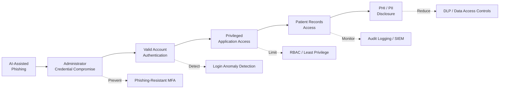

# Scenario 1 – Risk Summary

## Scenario

**AI-Assisted Phishing and Credential Compromise**

This scenario considers an attacker using AI-assisted social engineering to target a privileged administrator of Solaris Care Connect 360.

If the phishing attempt succeeds, the attacker may obtain valid administrator credentials, authenticate through legitimate application workflows and gain access to sensitive patient information.

---

## Scenario-Specific Risk Assessment

| Risk ID | Risk Description | Primary Asset | Likelihood | Impact | Inherent Risk | Recommended Controls |
|---|---|---|---|---|---|---|
| **S1-R1** | AI-assisted phishing successfully compromises a privileged administrator's credentials | Administrator identity | High | High | **High** | Phishing-resistant MFA, secure email filtering, security awareness training |
| **S1-R2** | Stolen credentials are used to authenticate to Solaris Care Connect 360 as a legitimate privileged user | Authentication Service / privileged account | High | High | **High** | MFA, conditional access, login anomaly detection, credential rotation |
| **S1-R3** | A compromised administrator account provides excessive access to sensitive patient information | Patient PHI / PII | Medium | High | **High** | RBAC, least privilege, Privileged Access Management, step-up authentication |
| **S1-R4** | Malicious activity performed through a valid authenticated session is not detected quickly enough | Application sessions / audit records | Medium | High | **High** | Centralised logging, SIEM alerting, behavioural analytics, session revocation |
| **S1-R5** | Sensitive patient information is accessed or exfiltrated through legitimate application functionality | Patient records | Medium | High | **High** | Data access monitoring, rate limiting, DLP controls, audit logging and alerting |

---

## Relationship to the Master Risk Register

The `S1-R#` identifiers in this document are **local to Scenario 1**.

They should not be confused with the platform-wide STRIDE threat identifiers used elsewhere in the project.

For example:

| Scenario 1 Risk | Related Platform Threat |
|---|---|
| **S1-R1 – Administrator credentials compromised** | **S1 – Credential Phishing** |
| **S1-R2 – Stolen credentials used for authentication** | **S1 – Credential Phishing / Valid Account Abuse** |
| **S1-R3 – Excessive privileged access** | **E1 / E2 – Privilege Escalation** |
| **S1-R4 – Malicious authenticated activity goes undetected** | Related monitoring and repudiation concerns |
| **S1-R5 – Patient data accessed or exfiltrated** | **I1 / I2 – Information Disclosure risks** |

The authoritative numerical platform-wide risk scoring is maintained in:

**[Risk Register](../templates/risk-register.md)**

---

## Risk Rating Method

The risks in this scenario are assessed qualitatively using **Likelihood** and **Impact**.

### Likelihood

- **High** – The attack is credible and could reasonably occur without strong preventative controls.
- **Medium** – The attack is feasible but requires additional conditions or access.
- **Low** – The attack would require uncommon circumstances or several security failures.

### Impact

- **High** – Could result in significant compromise of patient information, privileged access or healthcare operations.
- **Medium** – Could cause limited data exposure or operational disruption.
- **Low** – Limited effect on confidentiality, integrity or availability.

---

## Scenario Risk Matrix

| Likelihood ↓ / Impact → | Low | Medium | High |
|---|---|---|---|
| **High** | Medium | High | **High** |
| **Medium** | Low | Medium | **High** |
| **Low** | Low | Low | Medium |

---

## Key Risk

The primary risk in this scenario is the compromise of a **privileged administrator identity**.

Because the attacker uses valid credentials after the initial phishing attack, subsequent activity may appear legitimate to the platform. This makes identity controls, least privilege, session monitoring and audit logging particularly important.

---

## Risk Treatment Priority

The recommended treatment priority is:

1. Prevent successful use of stolen credentials through phishing-resistant MFA.
2. Restrict privileged accounts using RBAC and least privilege.
3. Detect anomalous authentication and privileged-user behaviour.
4. Monitor access to sensitive patient records.
5. Rapidly revoke compromised sessions and credentials following detection.

---

## Related Documentation

- [Scenario 1 Overview](./README.md)
- [Attacker Flow](./Attacker%20Flow.md)
- [Required Security Controls](./Controls%20Required.md)
- [STRIDE Analysis](./STRIDE.md)
- [MITRE ATT&CK Sequence](./MITRE%20ATT%26CK%20Sequence%20Summary.md)
- [Master Risk Register](../templates/risk-register.md)
