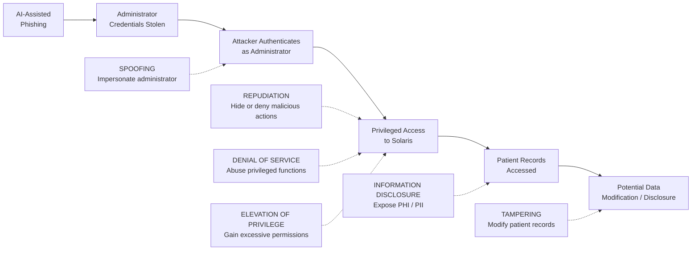

# Scenario 1 – STRIDE Threat Analysis

## Scenario

This STRIDE assessment analyses the **AI-assisted phishing and privileged credential compromise** scenario against Solaris Care Connect 360.

The attacker attempts to obtain valid administrator credentials through phishing, authenticate through legitimate application workflows and use the compromised identity to access sensitive patient information.

The analysis considers threats across the following components:

- Privileged Administrator
- Admin Dashboard
- API Gateway
- Authentication Service
- Patient Records Service
- PostgreSQL Patient Database

---

## STRIDE Assessment

| STRIDE Category | Threat Scenario | Affected Components | Security Impact | Related Risk | Required Controls |
|---|---|---|---|---|---|
| **Spoofing** | An attacker uses stolen administrator credentials to impersonate a legitimate privileged user | Admin Dashboard, Authentication Service | Unauthorised authenticated access | R1, R2 | Phishing-resistant MFA, conditional access, login anomaly detection |
| **Tampering** | A compromised administrator account modifies patient or clinical records | Patient Records Service, PostgreSQL | Loss of integrity of healthcare information | R3 | RBAC, least privilege, privileged access management, audit logging |
| **Repudiation** | The attacker performs actions through a legitimate account and later activity cannot be reliably attributed | API Gateway, Patient Records Service, audit records | Reduced accountability and incident investigation capability | R4 | Centralised logging, immutable audit trails, SIEM correlation |
| **Information Disclosure** | The compromised account accesses or exports PHI and PII without authorisation | Patient Records Service, PostgreSQL | Exposure of sensitive patient information | R3, R5 | RBAC, patient-record access monitoring, encryption, DLP |
| **Denial of Service** | A compromised privileged account abuses administrative functionality or application requests to disrupt service availability | API Gateway, backend services | Loss or degradation of healthcare service availability | Secondary | Rate limiting, availability monitoring, restricted administrative actions |
| **Elevation of Privilege** | The attacker uses the compromised account to obtain permissions beyond those required for the administrator's normal role | Authentication Service, Admin Dashboard, backend services | Increased access and larger compromise scope | R2, R3 | Least privilege, PAM, step-up authentication, separation of duties |

---

## STRIDE Analysis by Attack Stage

---

# S – Spoofing

## Threat

The attacker obtains the administrator's username and password through an AI-assisted phishing campaign and then presents those credentials to Solaris Care Connect 360.

Because the credentials belong to a legitimate user, the Authentication Service may treat the attacker as the real administrator.

### Affected Components

- Privileged Administrator
- Admin Dashboard
- API Gateway
- Authentication Service

### Security Impact

Successful spoofing allows an attacker to operate using a trusted privileged identity.

### Control Gap

Password-only authentication would provide insufficient protection against credential phishing.

### Required Controls

- Phishing-resistant MFA.
- Conditional access.
- Login anomaly detection.
- Secure email filtering.
- Security awareness training.

---

# T – Tampering

## Threat

After authentication, a compromised privileged account may attempt to modify:

- patient demographic information
- medical records
- clinical information
- account settings
- other sensitive application data

### Affected Components

- Patient Records Service
- PostgreSQL Patient Database
- Administrative functionality

### Security Impact

Unauthorised changes could compromise the **integrity of healthcare information** and potentially affect subsequent clinical or operational decisions.

### Control Gap

Excessive administrator permissions would increase the attacker's ability to modify sensitive records.

### Required Controls

- RBAC.
- Least privilege.
- Privileged Access Management.
- Strong authorisation checks.
- Audit logging for record modifications.

---

# R – Repudiation

## Threat

Because the attacker is using a legitimate administrator account, malicious actions may initially appear to have been performed by the real administrator.

Without sufficient audit evidence, it may be difficult to determine:

- who performed an action
- when it occurred
- which records were accessed
- which records were changed
- where the request originated

### Affected Components

- API Gateway
- Authentication Service
- Patient Records Service
- Security logs

### Security Impact

Weak accountability makes incident investigation, attribution and regulatory reporting more difficult.

### Control Gap

Security-relevant events must be logged centrally and protected against unauthorised alteration.

### Required Controls

- Centralised audit logging.
- SIEM monitoring.
- Time-synchronised logs.
- Protected or immutable audit records.
- Correlation of authentication and patient-access events.

---

# I – Information Disclosure

## Threat

The attacker uses the compromised administrator identity to access patient information that they are not authorised to view.

Sensitive information could include:

- Protected Health Information (PHI)
- Personally Identifiable Information (PII)
- medical histories
- prescriptions
- laboratory results
- insurance information

### Affected Components

- Patient Records Service
- PostgreSQL Patient Database
- Document Storage
- Admin Dashboard

### Security Impact

Unauthorised disclosure could result in significant patient privacy, regulatory and reputational consequences.

### Control Gap

A privileged identity should not automatically provide unrestricted access to all patient information.

### Required Controls

- RBAC.
- Least privilege.
- Encryption in transit and at rest.
- Patient-record access monitoring.
- DLP controls.
- Alerts for unusual or bulk record access.

---

# D – Denial of Service

## Threat

Although denial of service is not the primary objective of this phishing scenario, a compromised privileged account could potentially abuse administrative functionality or generate disruptive application activity.

Examples include:

- disabling legitimate accounts
- abusing administrative operations
- generating excessive API requests
- interfering with application availability

### Affected Components

- API Gateway
- Authentication Service
- Backend services

### Security Impact

Disruption could reduce availability of a healthcare platform relied upon by patients and clinical users.

### Control Gap

Privileged access should not allow a single compromised identity to cause widespread service disruption without safeguards.

### Required Controls

- Rate limiting.
- Availability monitoring.
- Restricted administrative actions.
- Approval for high-impact operations.
- Incident-response procedures.

---

# E – Elevation of Privilege

## Threat

After compromising an administrator account, the attacker may attempt to obtain permissions beyond those normally assigned to that identity.

Examples include:

- assigning additional roles
- creating new privileged accounts
- changing access-control settings
- gaining access to additional backend services

### Affected Components

- Admin Dashboard
- Authentication Service
- API Gateway
- Backend services

### Security Impact

Successful privilege escalation increases the attacker's access and the potential blast radius of the incident.

### Control Gap

Administrative access should be tightly scoped and sensitive privilege changes should require additional controls.

### Required Controls

- Least privilege.
- Privileged Access Management.
- Separation of duties.
- Step-up authentication.
- Monitoring of role and permission changes.
- Alerts for creation of privileged identities.

---

## STRIDE Control Gap Summary

| STRIDE | Primary Control Gap | Priority |
|---|---|---|
| **Spoofing** | Stolen credentials could be accepted as legitimate | **Critical** |
| **Tampering** | Compromised privileged identities may modify sensitive records | **High** |
| **Repudiation** | Malicious activity may be difficult to attribute without strong audit evidence | **High** |
| **Information Disclosure** | Privileged access may expose large volumes of PHI/PII | **Critical** |
| **Denial of Service** | Privileged functionality could potentially be abused to affect availability | **Medium** |
| **Elevation of Privilege** | Compromised accounts may attempt to obtain additional permissions | **High** |

---

## STRIDE Conclusion

The most significant STRIDE concerns for Scenario 1 are **Spoofing** and **Information Disclosure**.

The attack begins with identity compromise: the attacker attempts to impersonate a legitimate privileged administrator using stolen credentials. If successful, the trusted identity can then be used to access sensitive healthcare information.

Defence therefore requires multiple layers:

**prevent credential abuse → restrict privileged access → detect abnormal behaviour → protect patient information → maintain reliable audit evidence.**
