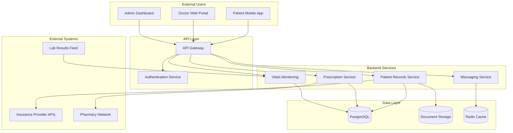

# Solaris Care Connect 360 – System Architecture

## Overview

Solaris Care Connect 360 is a healthcare platform supporting approximately **50,000 active patient records**.

The platform provides:

- patient mobile access
- doctor web access
- administrative functionality
- patient-record management
- prescription management
- secure messaging
- real-time vital-sign monitoring
- integrations with insurance providers, pharmacies and laboratories

---

## Architecture Diagram

---

## Components

### Frontend Applications

- **Patient Mobile App** – iOS/Android application used by patients.
- **Doctor Web Portal** – web interface used by healthcare professionals.
- **Admin Dashboard** – privileged interface used for administrative functions.

### Backend Services

- **API Gateway** – central entry point for application requests, routing and rate limiting.
- **Authentication Service** – manages authentication, sessions and identity validation.
- **Patient Records Service** – manages patient healthcare information.
- **Prescription Service** – manages prescriptions and pharmacy integration.
- **Messaging Service** – supports doctor-patient communication.
- **Vitals Monitoring** – processes real-time patient health information.

### Data Stores

- **PostgreSQL** – primary patient-data database.
- **Document Storage** – stores healthcare documents and files.
- **Redis Cache** – supports session and temporary application data.

### External Integrations

- Insurance Provider APIs
- Pharmacy Network
- Lab Results Feed

---

## Entry Points

The primary system entry points are:

- Patient Mobile App API endpoints
- Doctor Web Portal login
- Admin Dashboard access
- API Gateway
- Insurance provider integrations
- Lab results API/feed
- Pharmacy integration
- Email notifications
- SMS alerts

Each entry point represents a potential attack surface and should be subject to appropriate authentication, validation, monitoring and access control.

---

## Trust Boundaries

### TB1 – Internet → API Gateway

External traffic moves from an untrusted environment into the Solaris application environment.

**Required protections:**

- TLS
- authentication
- input validation
- rate limiting
- security monitoring

---

### TB2 – API Gateway → Backend Services

Requests move from the externally accessible API layer into trusted internal application services.

**Required protections:**

- service-level authorisation
- token validation
- RBAC
- least privilege
- logging

---

### TB3 – Backend Services → Data Layer

Application services access highly sensitive healthcare data.

**Required protections:**

- encrypted connections
- database least privilege
- parameterised queries
- access logging
- database activity monitoring

---

### TB4 – Backend Services → External APIs

Solaris exchanges information with external healthcare organisations.

**Required protections:**

- authenticated APIs
- mutual TLS where appropriate
- input validation
- restricted data sharing
- integration monitoring

---

## Sensitive Assets

The architecture processes:

- Protected Health Information (PHI)
- Personally Identifiable Information (PII)
- patient medical records
- prescriptions
- laboratory results
- insurance information
- authentication credentials
- session/access tokens

These assets form the primary focus of the Solaris Care Connect 360 threat model.

---

## Related Documentation

- [Level 0 DFD](./dfd-level0.md)
- [Level 1 DFD](./dfd-level1.md)
- [Attack Trees](./attack-trees.md)
- [Detailed High-Level Design](../HLD.md)
