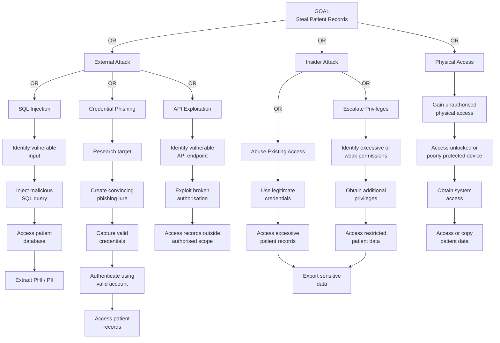
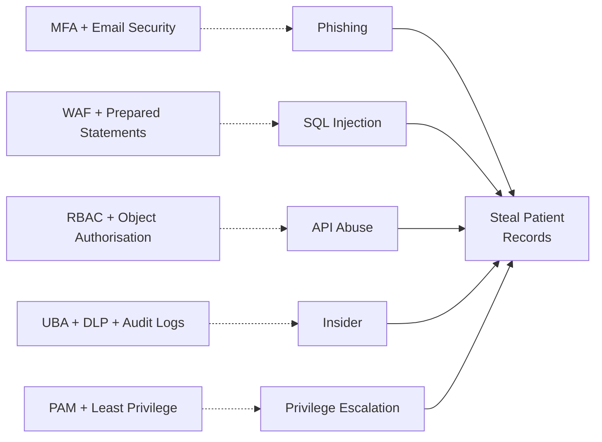

# Attack Trees – Solaris Care Connect 360

## Overview

Attack trees show the different paths an attacker could use to achieve a security objective.

For Solaris Care Connect 360, the primary objective modelled is:

> **Steal sensitive patient records**

The attack tree considers three broad routes:

- external attack
- insider attack
- physical access

The analysis helps identify which attack paths are most realistic and which controls should receive priority.

---

# Attack Goal – Steal Patient Records



---

# Attack Path Analysis

## Path 1 – SQL Injection

### Objective

Exploit an internet-facing application vulnerability to retrieve sensitive information from the patient database.

### Attack Sequence

```text
Identify vulnerable input
        ↓
Submit malicious SQL
        ↓
Application processes unsafe query
        ↓
Database returns unauthorised information
        ↓
PHI / PII exposed
```

### Preconditions

- vulnerable database interaction exists
- attacker can reach the affected application endpoint
- input is not safely parameterised
- database account possesses sufficient permissions

### Primary Controls

- parameterised queries
- server-side input validation
- Web Application Firewall
- least-privilege database accounts
- Database Activity Monitoring
- application security testing

### Related Risks

- **I1 – SQL Injection Data Breach**
- **E3 – SQL Injection to DBA**

---

# Path 2 – Credential Phishing

### Objective

Compromise a legitimate Solaris identity and use the account to access patient information.

### Attack Sequence

```text
Identify target
      ↓
Create phishing lure
      ↓
Capture credentials
      ↓
Authenticate as victim
      ↓
Access patient records
```

### Preconditions

- attacker can identify a Solaris user
- phishing message reaches the target
- victim submits credentials
- authentication controls do not prevent account abuse

### Primary Controls

- phishing-resistant MFA
- secure email filtering
- security awareness training
- conditional access
- login anomaly detection
- RBAC
- least privilege

### Related Risk

- **S1 – Credential Phishing**

Detailed analysis is available in:

**[Scenario 1 – AI-Assisted Phishing and Credential Compromise](../Scenario%201/README.md)**

---

# Path 3 – API Exploitation

### Objective

Exploit weaknesses in API authorisation to obtain records outside the attacker's legitimate access.

### Attack Sequence

```text
Identify API endpoint
      ↓
Manipulate object / record identifier
      ↓
Authorisation check fails
      ↓
Access another patient's data
```

### Example

A patient may attempt to modify a record identifier in an API request:

```text
GET /patients/1001
```

to:

```text
GET /patients/1002
```

If Solaris validates authentication but fails to verify whether the requester is authorised to access patient `1002`, sensitive information could be exposed.

### Primary Controls

- object-level authorisation
- RBAC
- server-side access controls
- API security testing
- access monitoring
- data minimisation

### Related Risks

- **E5 – IDOR / Cross-Patient Record Access**
- **I2 – Excessive Data Return**

---

# Path 4 – Insider Abuse

### Objective

A legitimate user deliberately abuses authorised system access to obtain sensitive patient information.

### Attack Sequence

```text
Legitimate system access
        ↓
Search for patient information
        ↓
Access records beyond business need
        ↓
Collect large quantities of PHI / PII
        ↓
Export sensitive information
```

### Why This Path Is Different

The insider may already have:

- valid credentials
- system knowledge
- legitimate access
- knowledge of internal processes

Traditional perimeter controls may therefore provide limited protection.

### Primary Controls

- least privilege
- RBAC
- User Behaviour Analytics
- patient-access monitoring
- Data Loss Prevention
- Database Activity Monitoring
- tamper-resistant audit logging
- regular access reviews

---

# Path 5 – Privilege Escalation

### Objective

Use an existing account to obtain permissions beyond those originally assigned.

### Possible Examples

- patient → doctor privileges
- doctor → administrator privileges
- compromised application account → database privileges

### Primary Controls

- RBAC
- least privilege
- Privileged Access Management
- separation of duties
- server-side authorisation
- role-change alerts
- regular access reviews

### Related Risks

- **E1 – Patient-to-Doctor Privilege Escalation**
- **E2 – Doctor-to-Administrator Privilege Escalation**
- **E3 – SQL Injection to DBA**

---

# Physical Access Path

Physical compromise is shown in the attack tree because it represents another theoretical method of reaching the attack objective.

However, **physical security is outside the defined scope of this threat-model assessment**.

It is therefore not analysed or risk-scored in detail.

---

# Attack Path Comparison

| Attack Path | Attacker Position | Difficulty | Potential Impact | Detection Difficulty | Priority |
|---|---|---|---|---|---|
| **Credential Phishing** | External | Low–Medium | High | Medium | **Critical** |
| **SQL Injection** | External | Medium | Severe | Medium | **Critical** |
| **API Authorisation Abuse** | Authenticated / External | Medium | High | Medium | **High** |
| **Insider Abuse** | Internal | Low | High | High | **High** |
| **Privilege Escalation** | Authenticated / Compromised | Medium | High | Medium | **High** |
| **Physical Access** | Physical | High | High | High | Out of Scope |

---

# Most Likely Attack Path

Based on the current assessment, **credential phishing** represents one of the easiest realistic attack paths.

The attacker does not necessarily need to discover a technical vulnerability. Instead, they attempt to obtain a legitimate identity and interact with Solaris through normal application functionality.

This corresponds to:

**S1 – Credential Phishing**

with a risk score of:

**16/25 – Critical**

---

# Highest-Impact Attack Path

**SQL injection** represents one of the highest-impact technical attack paths because a successful vulnerability could provide access to large quantities of sensitive patient information.

This corresponds to:

**I1 – SQL Injection Data Breach**

with a risk score of:

**20/25 – Critical**

---

# Detection Points

| Attack Step | Detection Method | Example Indicator |
|---|---|---|
| Phishing delivery | Email security monitoring | Suspicious sender, URL or attachment |
| Stolen credential use | Authentication monitoring | New device, unusual location or abnormal login |
| API exploitation | API / application logging | Repeated requests for unauthorised objects |
| SQL injection | WAF / application monitoring | SQL syntax or abnormal query patterns |
| Database access | Database Activity Monitoring | Unusual queries or bulk record retrieval |
| Insider abuse | Behaviour analytics | Access inconsistent with normal job function |
| Bulk export | DLP | Large volume of patient information transferred |
| Privilege escalation | IAM / SIEM | Unexpected role or permission changes |

---

# Attack Tree Control Coverage



---

# Mitigation Priority

The attack-tree analysis supports the following control priorities:

1. **Phishing-resistant MFA and security awareness training** to reduce identity compromise.
2. **Prepared statements, input validation and WAF protection** to reduce SQL injection risk.
3. **RBAC and object-level authorisation** to prevent unauthorised API access.
4. **Least privilege and PAM** to restrict privilege escalation.
5. **UBA, Database Activity Monitoring and DLP** to detect insider activity and bulk patient-data access.
6. **Centralised audit logging and SIEM** to provide visibility across multiple attack paths.

---

# Key Finding

There is no single route to patient information.

An attacker may attempt to achieve the same objective by compromising:

**identity, application security, API authorisation, privileges or trusted internal access.**

This demonstrates why Solaris Care Connect 360 requires **defence in depth** rather than relying on a single security control.

---

## Related Documentation

- [System Architecture](../HLD.md)
- [Data Flow Diagrams](../Data%20Flow%20Diagram.md)
- [STRIDE Threat Register](../templates/stride-threats.md)
- [MITRE ATT&CK Mapping](../templates/mitre-mapping.md)
- [Risk Register](../templates/risk-register.md)
- [Control Mapping](../templates/control-mapping.md)
- [Scenario 1 – Credential Phishing](../Scenario%201/README.md)
