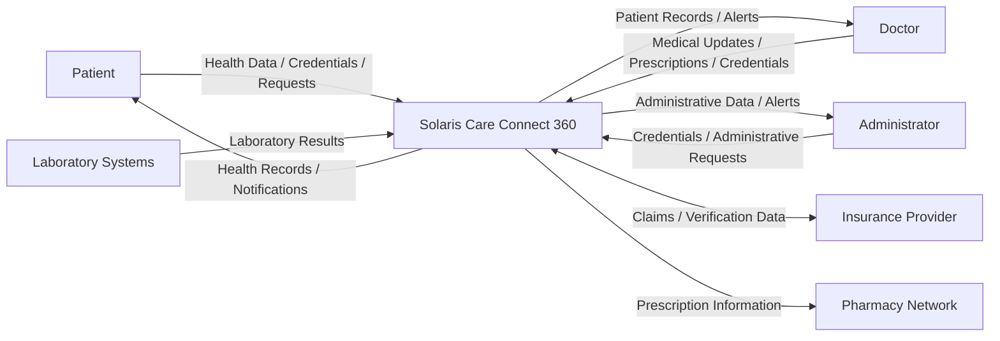

# Level 0 Data Flow Diagram – Solaris Care Connect 360

## Overview

The Level 0 Data Flow Diagram provides a high-level view of Solaris Care Connect 360 as a single system and shows the external entities that exchange information with it.

The purpose of this diagram is to identify:

- external users
- external healthcare organisations
- sensitive data entering and leaving the platform
- major trust relationships

---

## Level 0 DFD

---

## External Entities

| External Entity | Role | Data Exchanged |
|---|---|---|
| **Patient** | End user accessing healthcare services | Credentials, health data, patient records, notifications |
| **Doctor** | Healthcare professional accessing and updating clinical information | Credentials, patient records, prescriptions, medical updates |
| **Administrator** | Privileged user performing administrative functions | Credentials, administrative requests, account-management data |
| **Insurance Provider** | External insurance service | Claims, verification information, patient/insurance data |
| **Pharmacy Network** | External prescription fulfilment service | Prescription information |
| **Laboratory Systems** | External provider of test results | Laboratory results and patient identifiers |

---

## Sensitive Data Flows

### Protected Health Information (PHI)

PHI flows include:

- patient medical records
- laboratory results
- prescriptions
- vital-sign information
- clinical updates

### Personally Identifiable Information (PII)

PII flows include:

- patient demographic information
- account identifiers
- insurance information
- authentication-related identity information

### Authentication Data

Authentication-related flows include:

- usernames
- passwords or authentication credentials
- access/session tokens
- privileged administrator credentials

---

## Trust Boundary Considerations

At Level 0, all external entities are treated as being outside the Solaris Care Connect 360 trust boundary.

This means all inbound data should be treated as **untrusted until validated**.

Important security requirements include:

- authenticated communication
- TLS encryption
- input validation
- authorisation
- rate limiting
- audit logging
- monitoring

---

## Key Threats at Level 0

Potential threats include:

- credential phishing
- unauthorised account access
- malicious API requests
- spoofed external integrations
- manipulation of incoming laboratory information
- interception of healthcare data
- excessive or unauthorised information disclosure
- denial-of-service attacks

These threats are assessed in more detail using STRIDE, MITRE ATT&CK and the Cyber Kill Chain.

---

## Security Principle

Any data crossing from an external entity into Solaris Care Connect 360 should be considered untrusted.

The platform should therefore apply:

**authenticate → validate → authorise → process → log**

before sensitive healthcare information is accessed or modified.

---

## Related Documentation

- [System Architecture](./architecture.md)
- [Level 1 DFD](./dfd-level1.md)
- [Attack Trees](./attack-trees.md)
- [STRIDE Threat Register](../templates/stride-threats.md)
