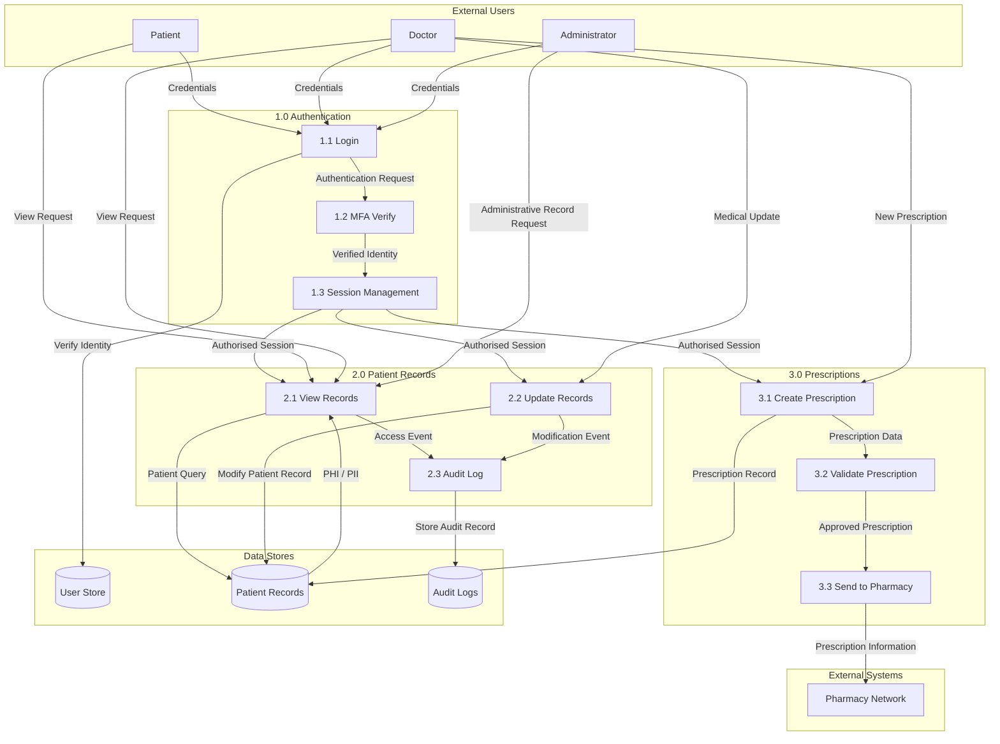

# Level 1 Data Flow Diagram – Solaris Care Connect 360

## Overview

The Level 1 Data Flow Diagram expands Solaris Care Connect 360 into its main internal processes and data stores.

It shows how authentication, patient records and prescription data move through the platform and highlights the sensitive information that crosses internal trust boundaries.

---

## Level 1 DFD



---

## Process 1.0 – Authentication

### 1.1 Login

Patients, doctors and administrators submit authentication credentials.

### 1.2 MFA Verify

A second authentication factor is used to strengthen identity verification.

### 1.3 Session Management

Following successful authentication, the user receives an authorised session.

### Sensitive Data

- usernames
- passwords / authentication credentials
- MFA information
- session tokens

### Security Requirements

- TLS encryption
- secure credential storage
- MFA
- session expiration
- token protection
- authentication logging
- anomaly detection

---

## Process 2.0 – Patient Records

### 2.1 View Records

Authorised users request patient healthcare information.

### 2.2 Update Records

Healthcare professionals submit authorised changes to patient information.

### 2.3 Audit Log

Record access and modification events are logged for accountability and investigation.

### Sensitive Data

- patient demographics
- medical history
- diagnoses
- treatment information
- laboratory results
- other PHI

### Security Requirements

- RBAC
- object-level authorisation
- least privilege
- encryption
- audit logging
- patient-access monitoring
- data minimisation

---

## Process 3.0 – Prescriptions

### 3.1 Create Prescription

A healthcare professional creates a new prescription.

### 3.2 Validate Prescription

The system validates the prescription before processing.

### 3.3 Send to Pharmacy

Approved prescription information is transmitted to the external pharmacy network.

### Sensitive Data

- patient identity
- medication
- dosage
- prescription details

### Security Requirements

- strong authorisation
- integrity validation
- encrypted transmission
- audit logging
- authenticated pharmacy integration

---

# Data Classification

| Data Type | Classification | Encryption Required | Logging Required |
|---|---|---|---|
| **Patient Records** | PHI – Critical | Yes – in transit and at rest | Yes – access and modification |
| **Login Credentials** | PII / Sensitive – High | Yes – secure transmission and password hashing | Yes – authentication events |
| **Session Tokens** | Sensitive – High | Yes – secure transport and storage | Yes – access events |
| **Prescription Data** | PHI – Critical | Yes – in transit and at rest | Yes – creation and modification |
| **Audit Logs** | Internal / Security Sensitive | Yes – at rest | N/A – logs are the audit evidence |

---

# Trust Boundaries

## TB1 – External Users → Authentication Processes

Untrusted users submit data into Solaris.

### Threats

- credential phishing
- brute-force attacks
- malicious input
- account takeover

### Controls

- MFA
- TLS
- rate limiting
- secure authentication
- login anomaly detection

---

## TB2 – Authentication → Internal Processes

Authenticated sessions are used to access patient and prescription functionality.

### Threats

- stolen-token reuse
- privilege escalation
- broken access control
- excessive permissions

### Controls

- token validation
- RBAC
- least privilege
- session monitoring
- server-side authorisation

---

## TB3 – Application Processes → Data Stores

Backend processes access sensitive healthcare information.

### Threats

- SQL injection
- excessive database privileges
- unauthorised record access
- data modification
- information disclosure

### Controls

- parameterised queries
- least-privilege database accounts
- encryption
- Database Activity Monitoring
- audit logging

---

## TB4 – Prescription Service → Pharmacy Network

Prescription information leaves the Solaris environment and is transferred to an external healthcare organisation.

### Threats

- interception
- spoofed pharmacy systems
- prescription tampering
- unauthorised disclosure

### Controls

- TLS / mutual TLS
- strong API authentication
- integrity validation
- logging and monitoring

---

# Sensitive Data Flow Examples

## Authentication Flow

```text
User
 ↓
Login
 ↓
MFA Verification
 ↓
Session Management
 ↓
Authorised Application Access
```

---

## Patient Record Flow

```text
Doctor / Patient
      ↓
Authorised Request
      ↓
Patient Records Process
      ↓
Patient Database
      ↓
PHI / PII Response
```

---

## Prescription Flow

```text
Doctor
  ↓
Create Prescription
  ↓
Validate
  ↓
Patient Database
  ↓
Pharmacy Network
```

---

# STRIDE Relevance

The Level 1 DFD provides the basis for STRIDE analysis.

Examples include:

| Component / Flow | Example STRIDE Threat |
|---|---|
| Login | **S1 – Credential Phishing** |
| Session Management | **S3 – Stolen Access Token** |
| Patient Records | **T1 – Patient Record Modification** |
| Patient Database | **I1 – SQL Injection Data Breach** |
| Prescription Service | **T2 – Prescription Tampering** |
| Audit Logs | **T3 – Audit Log Tampering / R1 Repudiation** |
| Authorisation | **E1 – Patient-to-Doctor Privilege Escalation** |

---

# Key Security Observation

Authentication alone is not sufficient to protect healthcare information.

Every request should be subjected to:

**authentication → authorisation → validation → least-privilege access → logging**

before sensitive patient information is returned or modified.

---

## Related Documentation

- [System Architecture](./architecture.md)
- [Level 0 DFD](./dfd-level0.md)
- [Attack Trees](./attack-trees.md)
- [STRIDE Threat Register](../templates/stride-threats.md)
- [Risk Register](../templates/risk-register.md)
