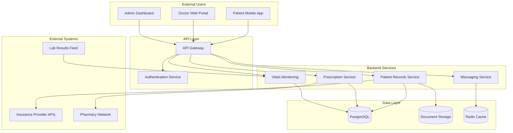
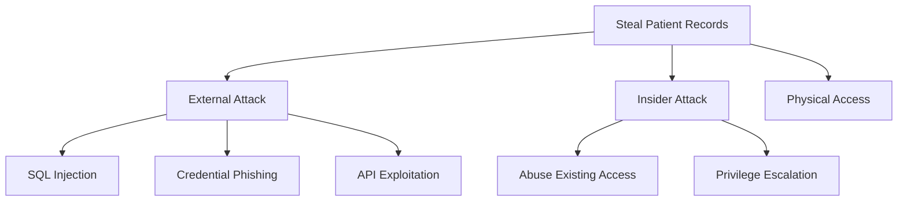
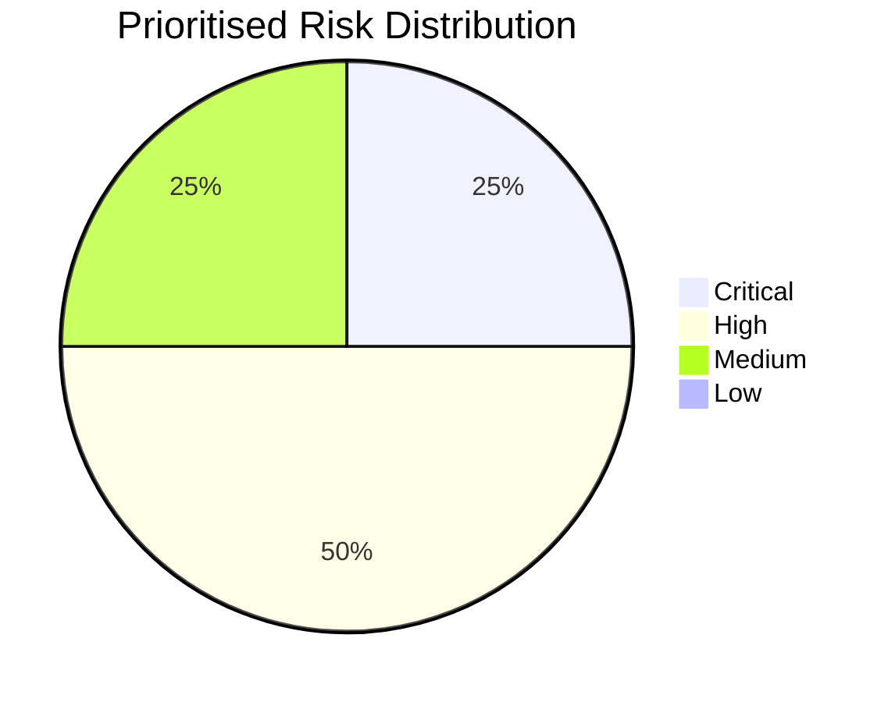
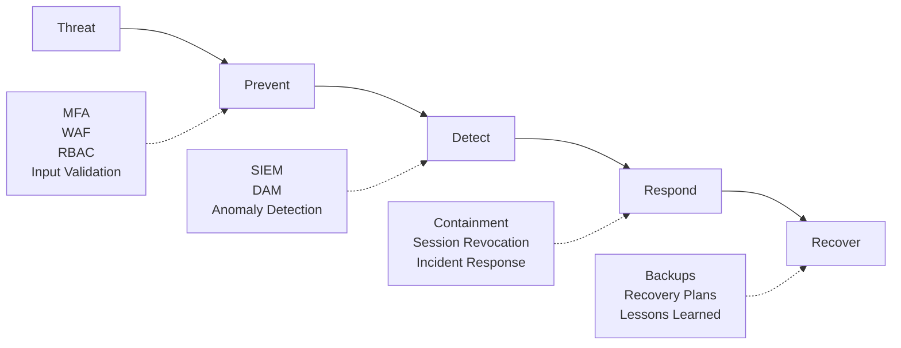
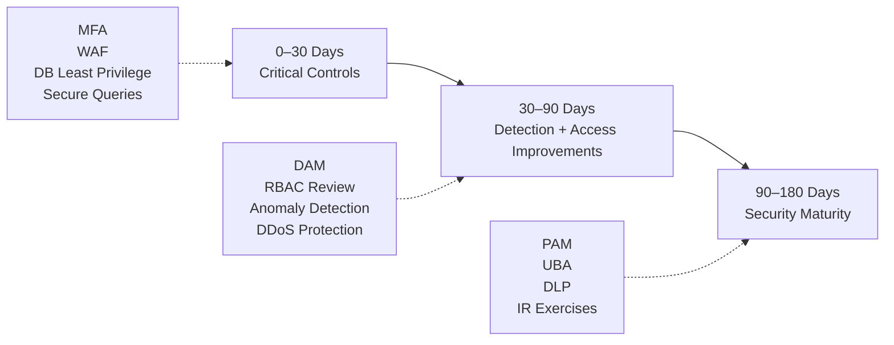
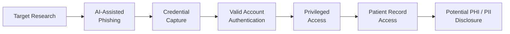

# Threat Model Report
## Solaris Care Connect 360

**Version:** 1.0  
**Date:** 13 October 2026  
**Author:** Mahammed Shadman Ahmed  
**Classification:** Confidential – Simulated Exercise

---

# Executive Summary

Solaris Care Connect 360 is a simulated healthcare platform supporting approximately **50,000 active patient records**, real-time vital-sign monitoring, prescription management, doctor-patient messaging and integrations with external healthcare organisations.

A structured threat-modelling assessment was performed using:

- **STRIDE**
- **MITRE ATT&CK**
- **Cyber Kill Chain**
- **Likelihood × Impact risk scoring**
- **NIST Cybersecurity Framework (CSF) 2.0 control mapping**
- **Attack-tree analysis**

The assessment identified significant risks affecting the confidentiality, integrity and availability of sensitive healthcare information.

## Overall Risk Posture

**Overall Risk Posture: HIGH**

The platform-wide STRIDE analysis identified **31 threat scenarios**.

Eight priority threats were selected for detailed numerical risk assessment.

| Severity | Count | Key Examples |
|---|---:|---|
| 🔴 **Critical** | **2** | SQL Injection Data Breach (I1), Credential Phishing (S1) |
| 🟠 **High** | **4** | SQLi to DBA (E3), Excessive API Data Return (I2), Privilege Escalation (E1), Prescription Tampering (T2) |
| 🟡 **Medium** | **2** | DDoS (D1), Prescription Repudiation (R1) |
| 🟢 **Low** | **0** | None |
| **Total** | **8** | |

---

## Top Three Findings

### 1. SQL Injection Could Expose Sensitive Patient Information

**I1 – SQL Injection Data Breach** received the highest risk score:

**Likelihood 4 × Impact 5 = 20/25 – Critical**

A successful SQL injection vulnerability within an internet-facing application or API could expose sensitive PHI and PII stored within the PostgreSQL patient database.

### 2. Credential Phishing Creates a Direct Identity-Based Attack Path

**S1 – Credential Phishing** was scored:

**Likelihood 4 × Impact 4 = 16/25 – Critical**

An attacker who obtains legitimate credentials may interact with Solaris through normal authentication and application workflows, making malicious activity more difficult to distinguish from legitimate activity.

### 3. Weak Privilege Boundaries Could Increase Breach Impact

High-risk threats including:

- SQL injection leading to elevated database privileges
- patient-to-doctor privilege escalation
- excessive API data exposure
- prescription-data tampering

demonstrate the importance of strong authorisation, least privilege and security monitoring across application and database layers.

---

## Critical Recommendations

| Recommendation | Primary Risks | Estimated Effort |
|---|---|---|
| **Implement phishing-resistant MFA** | S1 | Medium |
| **Deploy WAF and validate parameterised database queries** | I1, E3 | Medium |
| **Restrict database service-account privileges** | I1, E3 | Low |
| **Deploy Database Activity Monitoring** | I1, E3 | High |
| **Strengthen RBAC and object-level authorisation** | E1, I2 | Medium |
| **Implement authentication anomaly detection** | S1, E1 | Medium |

The most urgent objective is to reduce the likelihood of **identity compromise and application-level access to patient information**, while improving detection capability when preventive controls fail.

---

# 1. Scope & Methodology

## 1.1 Scope

The assessment covers the primary components of Solaris Care Connect 360:

- Patient Mobile App
- Doctor Web Portal
- Admin Dashboard
- API Gateway
- Authentication Service
- Patient Records Service
- Prescription Service
- Messaging Service
- Vitals Monitoring
- PostgreSQL patient database
- Document Storage
- Redis Cache
- Insurance Provider integrations
- Pharmacy Network
- Lab Results Feed

The platform manages approximately **50,000 active patient records** and processes sensitive healthcare and identity information.

---

## 1.2 Sensitive Information

The primary data types considered in the threat model are:

| Data Type | Classification |
|---|---|
| Patient medical records | PHI – Critical |
| Prescription information | PHI – Critical |
| Laboratory results | PHI – Critical |
| Patient demographics | PII – High |
| Authentication credentials | Sensitive – High |
| Session/access tokens | Sensitive – High |
| Insurance information | PII / Financial – High |
| Medical documents | PHI – Critical |

---

## 1.3 Methodology

The assessment applies several complementary approaches.

### STRIDE

Used to identify threats across:

- Spoofing
- Tampering
- Repudiation
- Information Disclosure
- Denial of Service
- Elevation of Privilege

### MITRE ATT&CK

Used to map selected threats to recognised adversary behaviours and techniques.

### Cyber Kill Chain

Used to analyse how attacks may progress from reconnaissance through to actions on objectives.

### Attack Trees

Used to visualise alternative attack paths that could achieve the objective of accessing or stealing sensitive patient information.

### Risk Scoring

Risks are scored using:

> **Risk Score = Likelihood × Impact**

Both Likelihood and Impact use a scale of **1–5**.

| Score | Priority |
|---:|---|
| **16–25** | Critical |
| **10–15** | High |
| **5–9** | Medium |
| **1–4** | Low |

### Security Control Mapping

Preventive, detective and corrective controls were mapped to relevant risk areas and aligned with the **NIST Cybersecurity Framework 2.0**.

---

## 1.4 Out of Scope

The following areas are not assessed in detail:

- physical security
- full third-party vendor assessments
- penetration testing
- source-code review
- production security-control validation

Physical access appears within the attack-tree analysis for completeness but is not formally risk-scored.

---

# 2. System Overview

## 2.1 High-Level Architecture



Detailed architecture documentation is available in:

**[System Architecture](../diagrams/architecture.md)**

---

## 2.2 Entry Points

Primary security-relevant entry points include:

- Patient Mobile App API endpoints
- Doctor Web Portal login
- Admin Dashboard access
- API Gateway
- Insurance provider integrations
- Pharmacy integration
- Lab results feed
- Email notifications
- SMS alerts

Each entry point represents a potential attack surface requiring appropriate authentication, validation, authorisation and monitoring.

---

## 2.3 Trust Boundaries

Four primary trust boundaries were identified:

| Trust Boundary | Description | Key Concern |
|---|---|---|
| **TB1** | Internet → API Gateway | Untrusted external traffic entering Solaris |
| **TB2** | API Layer → Backend Services | Authenticated requests entering internal services |
| **TB3** | Backend Services → Data Stores | Access to highly sensitive PHI/PII |
| **TB4** | Backend → External Healthcare APIs | Data crossing organisational boundaries |

Data crossing a trust boundary should be:

**authenticated → validated → authorised → encrypted → logged**

---

## 2.4 Sensitive Data Flows

### Authentication

```text
User
 ↓
Authentication Service
 ↓
Session / Access Token
 ↓
Application Access
```

### Patient Records

```text
User
 ↓
API
 ↓
Patient Records Service
 ↓
PostgreSQL
```

### Prescriptions

```text
Doctor
 ↓
Prescription Service
 ↓
Patient Database
 ↓
Pharmacy Network
```

### Laboratory Results

```text
Laboratory System
 ↓
Vitals Monitoring
 ↓
Patient Database
```

Detailed Data Flow Diagrams are available in:

- **[Level 0 DFD](../diagrams/dfd-level0.md)**
- **[Level 1 DFD](../diagrams/dfd-level1.md)**

---

# 3. Threat Analysis

## 3.1 STRIDE Summary

The platform-wide STRIDE assessment identified **31 threats**.

| STRIDE Category | Total | Critical | High | Medium | Low |
|---|---:|---:|---:|---:|---:|
| **Spoofing** | 5 | 2 | 2 | 1 | 0 |
| **Tampering** | 5 | 3 | 2 | 0 | 0 |
| **Repudiation** | 5 | 0 | 3 | 2 | 0 |
| **Information Disclosure** | 6 | 3 | 2 | 1 | 0 |
| **Denial of Service** | 5 | 0 | 3 | 2 | 0 |
| **Elevation of Privilege** | 5 | 4 | 1 | 0 | 0 |
| **Total** | **31** | **12** | **13** | **6** | **0** |

Key STRIDE concerns include:

- identity impersonation
- manipulation of patient and prescription data
- weak audit evidence
- PHI / PII exposure
- service disruption
- privilege escalation
- third-party integration compromise

The complete register is available in:

**[STRIDE Threat Register](../templates/stride-threats.md)**

---

## 3.2 MITRE ATT&CK Mapping

MITRE ATT&CK was used to map selected Solaris threats to recognised adversary behaviours.

Key techniques identified include:

| Technique | ID | Application to Solaris |
|---|---|---|
| Spearphishing Link | **T1566.002** | Targeted credential-phishing attacks |
| Valid Accounts | **T1078** | Abuse of legitimate compromised credentials |
| Steal Application Access Token | **T1528** | Theft and reuse of application or session tokens |
| Exploit Public-Facing Application | **T1190** | Exploitation of internet-facing applications, including SQL injection paths |
| Trusted Relationship | **T1199** | Abuse of a compromised trusted healthcare integration |
| Adversary-in-the-Middle | **T1557** | Interception or manipulation of external integration traffic |
| Create Account | **T1136** | Creation of unauthorised accounts to maintain access |
| Account Manipulation | **T1098** | Modification of existing account roles or privileges |
| Indicator Removal | **T1070** | Removal or manipulation of security evidence |
| Escape to Host | **T1611** | Container breakout where containerised infrastructure is applicable |
| Data from Information Repositories | **T1213** | Collection of sensitive information from repositories |
| Exfiltration Over Web Service | **T1567** | Potential transfer of collected information through external web services |

> ATT&CK techniques are mapped to attacker behaviour rather than directly to every application vulnerability. Techniques such as T1567 are only applicable where the corresponding exfiltration behaviour is explicitly present.

### Identity-Based Attack Path

```text
T1566.002 – Spearphishing Link
        ↓
Credential Capture
        ↓
T1078 – Valid Accounts
        ↓
Privileged Application Access
        ↓
T1213 – Data Collection
        ↓
Potential PHI / PII Disclosure
```

This attack path demonstrates how an attacker may bypass traditional perimeter defences by obtaining and abusing a legitimate Solaris identity.

Primary controls include:

- phishing-resistant MFA
- secure email filtering
- security awareness training
- RBAC and least privilege
- login anomaly detection
- patient-record access monitoring

### Application-Based Attack Path

```text
Internet-Facing Application
        ↓
T1190 – Exploit Public-Facing Application
        ↓
SQL Injection
        ↓
Database Access
        ↓
PHI / PII Disclosure
```

Primary controls include:

- parameterised SQL queries
- server-side input validation
- Web Application Firewall
- database least privilege
- Database Activity Monitoring

### Trusted Integration Attack Path

```text
Trusted External Healthcare Provider
        ↓
T1199 – Trusted Relationship
        ↓
Compromised Integration
        ↓
Fraudulent / Manipulated Data
        ↓
Solaris Backend Service
        ↓
Healthcare Data Integrity Impact
```

Solaris relies on trusted integrations with laboratories, pharmacies and insurance providers. Compromise of a trusted third party could therefore create an additional route into the healthcare environment.

Primary controls include:

- strong API authentication
- mutual TLS
- certificate validation
- message integrity validation
- restricted third-party access
- integration monitoring

The complete mapping is available in:

**[MITRE ATT&CK Mapping](../templates/mitre-mapping.md)**

---

## 3.3 Cyber Kill Chain Analysis

The assessment considered both external ransomware activity and insider abuse.

### External Ransomware Scenario

```text
Reconnaissance
      ↓
Weaponization
      ↓
Delivery
      ↓
Exploitation
      ↓
Installation
      ↓
Command & Control
      ↓
Actions on Objectives
```

Security controls provide opportunities to interrupt the attack at multiple stages.

| Kill Chain Stage | Example Defensive Control |
|---|---|
| Reconnaissance | Threat monitoring |
| Weaponization | Malware sandboxing |
| Delivery | Secure email filtering |
| Exploitation | EDR, patch management |
| Installation | File integrity monitoring |
| Command & Control | NDR, DNS monitoring, egress filtering |
| Actions on Objectives | DAM, DLP, backup and recovery |

### Insider Threat Scenario

An insider may already possess:

- valid credentials
- system knowledge
- legitimate network access
- authorised access to patient information

This reduces the effectiveness of traditional perimeter controls and increases the importance of:

- RBAC
- least privilege
- User Behaviour Analytics
- Data Loss Prevention
- Database Activity Monitoring
- tamper-resistant audit logging
- regular access reviews

Full analysis:

**[Cyber Kill Chain Analysis](../templates/kill-chain-analysis.md)**

---

## 3.4 Attack Tree Analysis

The primary attack-tree objective was:

> **Steal Patient Records**



The analysis identified several routes to sensitive patient information:

- SQL injection
- credential phishing
- API authorisation weaknesses
- insider abuse
- privilege escalation

Physical access was included for completeness but remains outside the formal assessment scope.

### Most Accessible Attack Path

**Credential phishing** represents a comparatively accessible attack path because an attacker may not need to discover a technical application vulnerability.

### Highest-Impact Technical Path

**SQL injection** represents a particularly high-impact technical path because successful exploitation could expose large volumes of PHI and PII.

Detailed analysis:

**[Attack Trees](../diagrams/attack-trees.md)**

---

# 4. Risk Assessment

## 4.1 Risk Methodology

Risk is calculated using:

> **Risk Score = Likelihood × Impact**

### Likelihood

| Score | Rating |
|---:|---|
| 1 | Rare |
| 2 | Unlikely |
| 3 | Possible |
| 4 | Likely |
| 5 | Almost Certain |

### Impact

| Score | Rating |
|---:|---|
| 1 | Negligible |
| 2 | Minor |
| 3 | Moderate |
| 4 | Major |
| 5 | Severe |

---

## 4.2 Risk Matrix

| Likelihood ↓ / Impact → | 1 – Negligible | 2 – Minor | 3 – Moderate | 4 – Major | 5 – Severe |
|---|---:|---:|---:|---:|---:|
| **5 – Almost Certain** | 5 Medium | 10 High | 15 High | 20 Critical | 25 Critical |
| **4 – Likely** | 4 Low | 8 Medium | 12 High | 16 Critical | 20 Critical |
| **3 – Possible** | 3 Low | 6 Medium | 9 Medium | 12 High | 15 High |
| **2 – Unlikely** | 2 Low | 4 Low | 6 Medium | 8 Medium | 10 High |
| **1 – Rare** | 1 Low | 2 Low | 3 Low | 4 Low | 5 Medium |

---

## 4.3 Prioritised Risks

| Rank | ID | Threat | Likelihood | Impact | Score | Priority |
|---:|---|---|---:|---:|---:|---|
| **1** | **I1** | SQL Injection Data Breach | 4 | 5 | **20** | 🔴 Critical |
| **2** | **S1** | Credential Phishing | 4 | 4 | **16** | 🔴 Critical |
| **3** | **E3** | SQL Injection to DBA | 3 | 5 | **15** | 🟠 High |
| **4** | **I2** | Excessive API Data Return | 4 | 3 | **12** | 🟠 High |
| **5** | **E1** | Patient-to-Doctor Privilege Escalation | 3 | 4 | **12** | 🟠 High |
| **6** | **T2** | Prescription Tampering | 2 | 5 | **10** | 🟠 High |
| **7** | **D1** | DDoS Against API Gateway | 3 | 3 | **9** | 🟡 Medium |
| **8** | **R1** | Prescription Approval Repudiation | 2 | 3 | **6** | 🟡 Medium |

---

## 4.4 Risk Distribution

| Severity | Count |
|---|---:|
| 🔴 **Critical** | **2** |
| 🟠 **High** | **4** |
| 🟡 **Medium** | **2** |
| 🟢 **Low** | **0** |



The complete scoring rationale is available in:

**[Risk Register](../templates/risk-register.md)**

---

## 4.5 Inherent and Residual Risk

The scores above represent **inherent risk** before the effectiveness of proposed controls is fully considered.

```text
Inherent Risk
      ↓
Security Controls Implemented
      ↓
Control Effectiveness Validated
      ↓
Residual Risk Reassessed
```

A risk should only be considered reduced after the relevant controls have been implemented and tested for effectiveness.

---

# 5. Security Control Assessment

## 5.1 Control Categories

Controls were assessed across three categories.

### Preventive Controls

Designed to prevent attacks from succeeding.

Examples include:

- MFA
- RBAC
- least privilege
- WAF
- parameterised queries
- encryption
- security awareness training

### Detective Controls

Designed to identify malicious activity.

Examples include:

- SIEM
- Database Activity Monitoring
- authentication anomaly detection
- patient-access monitoring
- User Behaviour Analytics
- audit logging

### Corrective Controls

Designed to contain and recover from incidents.

Examples include:

- session revocation
- credential rotation
- incident response
- backup and recovery
- remediation and patching

---

## 5.2 Key Control Gaps

| Gap | Risk | Recommended Control | Effort | Priority |
|---|---|---|---|---|
| WAF not represented | I1 | Deploy WAF with SQL injection protections | Medium | Critical |
| Database monitoring missing | I1 / E3 | Database Activity Monitoring | High | Critical |
| MFA incomplete | S1 | Phishing-resistant MFA | Medium | Critical |
| Security awareness gap | S1 | Recurring phishing awareness programme | Low | Critical |
| Authentication anomaly detection missing | S1 | Risk-based login monitoring | Medium | Critical |
| Excessive database privileges | E3 | Database privilege review | Low | High |
| RBAC requires improvement | E1 / I2 | Role and authorisation review | Medium | High |
| DDoS protection missing | D1 | DDoS mitigation and rate limiting | Medium | Medium |

> Control statuses represent assumptions within this simulated threat-modelling exercise and should be validated against a real environment before being relied upon.

---

## 5.3 Defence in Depth

The recommended controls operate across multiple security layers:



---

# 6. Recommendations

## 6.1 Immediate Actions – 0 to 30 Days

- [ ] Implement phishing-resistant MFA for privileged and high-risk accounts
- [ ] Deploy WAF protection for internet-facing applications and APIs
- [ ] Validate use of parameterised SQL queries
- [ ] Restrict database service-account permissions
- [ ] Begin security-awareness and phishing training

---

## 6.2 Short-Term Actions – 30 to 90 Days

- [ ] Deploy Database Activity Monitoring
- [ ] Complete RBAC and authorisation review
- [ ] Implement login and authentication anomaly detection
- [ ] Improve API response filtering and data minimisation
- [ ] Strengthen prescription audit logging
- [ ] Implement DDoS protection and rate limiting

---

## 6.3 Medium-Term Actions – 90 to 180 Days

- [ ] Implement Privileged Access Management
- [ ] Deploy User Behaviour Analytics
- [ ] Mature Data Loss Prevention capabilities
- [ ] Exercise incident-response procedures
- [ ] Review backup and recovery capability
- [ ] Establish recurring access reviews

---

## 6.4 Remediation Roadmap



---

# 7. NIST CSF 2.0 Alignment

The recommended controls align with the NIST Cybersecurity Framework 2.0.

| Function | Example Activities |
|---|---|
| **Identify** | Asset identification, architecture analysis, risk assessment |
| **Protect** | MFA, RBAC, encryption, secure development, security awareness |
| **Detect** | SIEM, Database Activity Monitoring, anomaly detection |
| **Respond** | Incident management, account containment, investigation |
| **Recover** | Backups, recovery planning, lessons learned |

The control assessment includes areas such as:

- Identity Management, Authentication and Access Control
- Awareness and Training
- Data Security
- Platform Security
- Technology Infrastructure Resilience
- Continuous Monitoring
- Adverse Event Analysis
- Incident Management
- Recovery Planning

Detailed mapping:

**[Security Control Mapping](../templates/control-mapping.md)**

---

# 8. Detailed Scenario – AI-Assisted Phishing and Credential Compromise

A detailed attack scenario was developed to demonstrate how the threat-modelling frameworks can be applied to a specific attack path.

## Scenario

An attacker researches a privileged Solaris administrator and uses AI-assisted social engineering to produce a convincing phishing email.

The administrator is directed to a fraudulent login page and submits valid credentials.

The attacker then attempts to authenticate to Solaris Care Connect 360 using the compromised identity and access sensitive patient information.

---

## Scenario Attack Path



The scenario demonstrates how a successful identity compromise can allow an attacker to operate using **legitimate application functionality** rather than exploiting the application directly.

---

## Scenario-Specific Controls

Key controls include:

- phishing-resistant MFA
- secure email filtering
- security awareness training
- conditional access
- login anomaly detection
- RBAC
- least privilege
- Privileged Access Management
- centralised logging
- patient-record access monitoring
- DLP
- rapid session revocation

Detailed scenario documentation:

**[Scenario 1 – AI-Assisted Phishing and Credential Compromise](../Scenario%201/README.md)**

---

# 9. Conclusion

The Solaris Care Connect 360 threat model identifies a broad attack surface created by internet-facing applications, privileged identities, sensitive healthcare information and external integrations.

The two highest-priority risks are:

> **I1 – SQL Injection Data Breach: 20/25 – Critical**

and:

> **S1 – Credential Phishing: 16/25 – Critical**

These findings demonstrate two fundamentally different attack routes:

### Technical Application Compromise

```text
Internet-Facing Application
        ↓
SQL Injection
        ↓
Database Access
        ↓
PHI / PII Exposure
```

### Trusted Identity Compromise

```text
Credential Phishing
        ↓
Credential Theft
        ↓
Valid Account Abuse
        ↓
Patient Record Access
```

The assessment also demonstrates the risks created by:

- external healthcare integrations
- excessive privileges
- weak object-level authorisation
- insufficient security monitoring
- healthcare-data integrity attacks
- availability threats
- insider activity

A strong defensive model for Solaris should therefore apply:

> **secure authentication → strong authorisation → application security → data protection → continuous monitoring → incident response → recovery**

Implementing the recommended controls would reduce the likelihood and potential impact of the identified threats.

Residual risk should be reassessed after control implementation and validation.

The threat model should also be reviewed following significant architectural, application or integration changes.

---

# Appendices

## Appendix A – Architecture

**[System Architecture](../diagrams/architecture.md)**

---

## Appendix B – Data Flow Diagrams

**[Level 0 Data Flow Diagram](../diagrams/dfd-level0.md)**

**[Level 1 Data Flow Diagram](../diagrams/dfd-level1.md)**

---

## Appendix C – STRIDE Threat Register

**[Complete STRIDE Threat Register](../templates/stride-threats.md)**

---

## Appendix D – MITRE ATT&CK Mapping

**[MITRE ATT&CK Mapping](../templates/mitre-mapping.md)**

---

## Appendix E – Cyber Kill Chain

**[Cyber Kill Chain Analysis](../templates/kill-chain-analysis.md)**

---

## Appendix F – Risk Register

**[Risk Register](../templates/risk-register.md)**

---

## Appendix G – Security Control Mapping

**[Security Control Mapping and Gap Analysis](../templates/control-mapping.md)**

---

## Appendix H – Attack Trees

**[Attack Tree Analysis](../diagrams/attack-trees.md)**

---

## Appendix I – Detailed Phishing Scenario

**[Scenario 1 – AI-Assisted Phishing and Credential Compromise](../Scenario%201/README.md)**

---

*This document represents a simulated cybersecurity threat-modelling exercise created for educational and portfolio purposes. No real patient information or production healthcare environment was assessed.*
