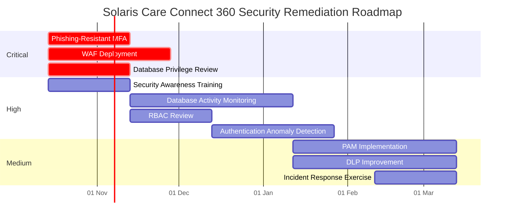
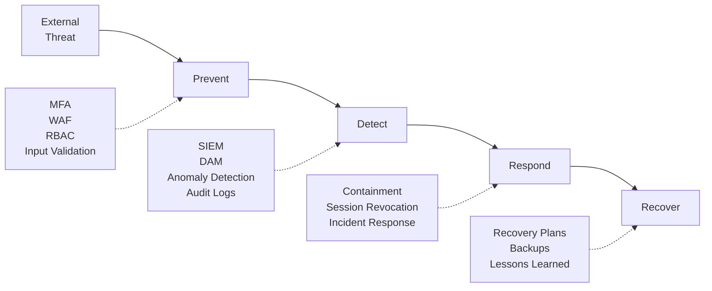

# Security Control Mapping – Solaris Care Connect 360

## Overview

This document maps the highest-priority risks identified in the Solaris Care Connect 360 risk assessment to preventive, detective and corrective security controls.

The assessment uses the **NIST Cybersecurity Framework (CSF) 2.0** to provide a recognised structure for security control implementation.

Control status is classified as:

- **Implemented** – Control is assumed to be present in the exercise environment.
- **Partial** – Some capability exists but additional improvement is required.
- **Missing** – The control is not currently represented and should be implemented.

> Control-status values represent assumptions within this threat-modelling exercise and are not claims about a real production healthcare environment.

---

# NIST CSF 2.0 Categories Used

| NIST CSF Category | Purpose |
|---|---|
| **PR.AA** | Identity Management, Authentication and Access Control |
| **PR.AT** | Awareness and Training |
| **PR.DS** | Data Security |
| **PR.PS** | Platform Security |
| **PR.IR** | Technology Infrastructure Resilience |
| **DE.CM** | Continuous Monitoring |
| **DE.AE** | Adverse Event Analysis |
| **RS.MA** | Incident Management |
| **RC.RP** | Incident Recovery Plan Execution |

---

# Control Mapping Matrix

| Risk ID | Risk | Control Type | Security Control | NIST CSF | Status |
|---|---|---|---|---|---|
| **I1** | SQL Injection Data Breach | Preventive | Prepared statements / parameterised queries | PR.PS | **Partial** |
| **I1** | SQL Injection Data Breach | Preventive | Server-side input validation | PR.PS | **Partial** |
| **I1** | SQL Injection Data Breach | Preventive | Web Application Firewall (WAF) | PR.PS | **Missing** |
| **I1** | SQL Injection Data Breach | Detective | Database Activity Monitoring | DE.CM | **Missing** |
| **S1** | Credential Phishing | Preventive | Multi-Factor Authentication | PR.AA | **Partial** |
| **S1** | Credential Phishing | Preventive | Security awareness and phishing training | PR.AT | **Missing** |
| **S1** | Credential Phishing | Preventive / Detective | Secure email filtering | PR.PS / DE.CM | **Implemented** |
| **S1** | Credential Phishing | Detective | Authentication anomaly detection | DE.AE | **Missing** |
| **E3** | SQL Injection to DBA | Preventive | Least-privilege database service accounts | PR.AA | **Missing** |
| **E3** | SQL Injection to DBA | Detective | Privileged database activity monitoring | DE.CM | **Missing** |
| **I2** | Excessive API Data Return | Preventive | API data minimisation and response filtering | PR.DS | **Partial** |
| **E1** | Patient-to-Doctor Privilege Escalation | Preventive | Role-Based Access Control (RBAC) | PR.AA | **Partial** |
| **E1** | Patient-to-Doctor Privilege Escalation | Detective | Access and privilege anomaly detection | DE.AE | **Missing** |
| **T2** | Prescription Tampering | Preventive | Strong authorisation for prescription changes | PR.AA | **Partial** |
| **T2** | Prescription Tampering | Detective | Prescription-change audit logging | DE.CM | **Partial** |
| **D1** | DDoS Against API Gateway | Preventive | DDoS protection and rate limiting | PR.IR | **Missing** |
| **D1** | DDoS Against API Gateway | Detective | Availability and traffic monitoring | DE.CM | **Partial** |
| **R1** | Prescription Approval Repudiation | Detective | Tamper-resistant audit logging | DE.CM | **Missing** |
| **R1** | Prescription Approval Repudiation | Corrective | Incident investigation procedures | RS.MA | **Partial** |

---

# Control Gap Analysis

## Critical Gaps

The highest-priority gaps are controls that are missing or incomplete for **Critical risks**.

| Gap ID | Related Risk | Control Gap | Risk Impact | Recommended Control | Effort | Priority |
|---|---|---|---|---|---|---|
| **GAP-01** | I1 | No WAF represented | SQL injection may reach application services without an additional filtering layer | Deploy WAF with SQL injection protections | Medium | **Critical** |
| **GAP-02** | I1 | Database monitoring missing | Malicious or unusual database access may not be detected quickly | Implement Database Activity Monitoring | High | **Critical** |
| **GAP-03** | S1 | MFA only partially implemented | Stolen passwords may still provide access to sensitive accounts | Implement phishing-resistant MFA for all privileged and high-risk accounts | Medium | **Critical** |
| **GAP-04** | S1 | Security awareness programme missing | Users remain more susceptible to targeted phishing | Establish recurring phishing and security-awareness training | Low | **Critical** |
| **GAP-05** | S1 | Authentication anomaly detection missing | Stolen credentials may be used without rapid detection | Implement login risk and anomaly detection | Medium | **Critical** |
| **GAP-06** | E3 | Database least privilege missing | SQL injection could have excessive database impact | Restrict database service-account permissions | Low | **High** |
| **GAP-07** | E1 | RBAC requires improvement | Users may obtain functionality outside their required role | Conduct RBAC and authorisation review | Medium | **High** |
| **GAP-08** | D1 | DDoS protection missing | API availability may be disrupted by high-volume attacks | Introduce DDoS protection and rate limiting | Medium | **Medium** |

---

# Critical Risk Control Coverage

## I1 – SQL Injection Data Breach

**Risk Score:** 20/25 – Critical

### Preventive

- parameterised queries
- server-side input validation
- Web Application Firewall
- secure coding practices
- vulnerability management

### Detective

- WAF alerts
- application-security logging
- Database Activity Monitoring
- SIEM correlation

### Corrective

- incident response
- vulnerable-code remediation
- credential rotation where compromise occurs
- forensic investigation

---

## S1 – Credential Phishing

**Risk Score:** 16/25 – Critical

### Preventive

- phishing-resistant MFA
- secure email filtering
- security awareness training
- conditional access

### Detective

- authentication anomaly detection
- SIEM monitoring
- suspicious-email reporting
- unusual-login alerts

### Corrective

- session revocation
- credential rotation
- account containment
- incident investigation

---

# High-Risk Control Coverage

## E3 – SQL Injection to DBA

Primary controls:

- database least privilege
- prepared statements
- WAF
- database hardening
- privileged activity monitoring

---

## I2 – Excessive API Data Return

Primary controls:

- data minimisation
- API response filtering
- object-level authorisation
- API security testing
- patient-access monitoring

---

## E1 – Patient-to-Doctor Privilege Escalation

Primary controls:

- RBAC
- least privilege
- server-side authorisation
- access reviews
- role-change monitoring

---

## T2 – Prescription Tampering

Primary controls:

- strong authorisation
- integrity validation
- approval workflows
- tamper-resistant logging
- change monitoring

---

# Medium-Risk Control Coverage

## D1 – DDoS Attack

Primary controls:

- rate limiting
- DDoS protection
- autoscaling
- traffic monitoring
- resilient architecture

---

## R1 – Prescription Approval Repudiation

Primary controls:

- authenticated approval actions
- tamper-resistant audit trails
- timestamps
- user and session correlation
- centralised security logging

---

# Recommended Remediation Priorities

## Immediate – 0 to 30 Days

| Action | Related Risks | Estimated Effort |
|---|---|---|
| Implement phishing-resistant MFA | S1 | Medium |
| Deploy WAF protections | I1, E3 | Medium |
| Restrict database service-account privileges | I1, E3 | Low |
| Validate parameterised queries across database interactions | I1, E3 | Medium |
| Begin security-awareness and phishing training | S1 | Low |

---

## Short Term – 30 to 90 Days

| Action | Related Risks | Estimated Effort |
|---|---|---|
| Deploy Database Activity Monitoring | I1, E3 | High |
| Complete RBAC and authorisation review | E1, I2 | Medium |
| Implement authentication anomaly detection | S1, E1 | Medium |
| Improve API data minimisation | I2 | Medium |
| Strengthen prescription audit trails | T2, R1 | Medium |
| Implement DDoS protection and rate limiting | D1 | Medium |

---

## Medium Term – 90 to 180 Days

| Action | Related Risks | Estimated Effort |
|---|---|---|
| Implement Privileged Access Management | E1, E3 | High |
| Deploy User Behaviour Analytics | S1, E1 | High |
| Mature DLP capabilities | I1, I2 | High |
| Exercise incident-response procedures | Multiple | Medium |
| Review backup and recovery controls | Availability risks | Medium |
| Establish recurring access reviews | E1, E3 | Medium |

---

# Control Implementation Roadmap

---

# Defence-in-Depth Model

---

# NIST CSF Alignment Summary

## Protect

Controls such as MFA, RBAC, encryption, WAF, secure development and awareness training reduce the likelihood of successful attacks.

## Detect

SIEM, Database Activity Monitoring, access monitoring and anomaly detection provide visibility when preventive controls fail.

## Respond

Incident-management procedures support containment, investigation, credential rotation and communication following compromise.

## Recover

Recovery planning and tested backups support restoration of healthcare services following disruptive incidents.

---

# Key Control Priorities

The assessment identifies three immediate security priorities:

1. **Strengthen identity protection** through phishing-resistant MFA.
2. **Reduce application and database attack exposure** through WAF protection, parameterised queries and database least privilege.
3. **Improve detection capability** through Database Activity Monitoring, SIEM and authentication anomaly detection.

These controls directly address the two Critical risks identified in the risk register:

- **I1 – SQL Injection Data Breach**
- **S1 – Credential Phishing**

---

## Related Documentation

- [STRIDE Threat Register](./stride-threats.md)
- [MITRE ATT&CK Mapping](./mitre-mapping.md)
- [Cyber Kill Chain Analysis](./kill-chain-analysis.md)
- [Risk Register](./risk-register.md)
- [System Architecture](../HLD.md)
- [Data Flow Diagrams](../Data%20Flow%20Diagram.md)
