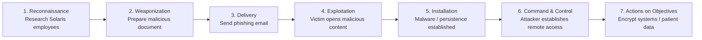
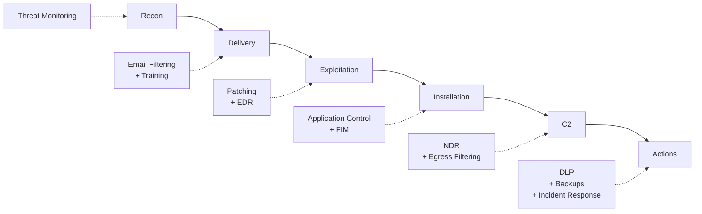
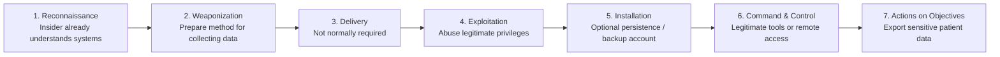

# Cyber Kill Chain Analysis – Solaris Care Connect 360

## Overview

The Cyber Kill Chain describes seven stages commonly involved in a cyber attack:

1. **Reconnaissance** – The attacker researches the target.
2. **Weaponization** – The attacker prepares the malicious capability or attack method.
3. **Delivery** – The attack is delivered to the target.
4. **Exploitation** – A vulnerability or user action is exploited.
5. **Installation** – Persistence or malicious tooling is established.
6. **Command & Control (C2)** – The attacker establishes remote control or communication.
7. **Actions on Objectives** – The attacker achieves the intended goal.

Analysing attacks at each stage helps identify opportunities to prevent, detect and contain malicious activity before the final objective is achieved.

---

# Scenario 1 – Ransomware via Phishing

## Scenario Overview

An attacker targets Solaris Care Connect 360 personnel with a phishing campaign.

The objective is to compromise a workstation, establish persistent access and eventually disrupt Solaris operations by encrypting systems or healthcare data and demanding payment.

---

## Kill Chain

---

## Stage Analysis

### 1. Reconnaissance

The attacker researches Solaris Care Connect 360 and identifies potential employees or privileged users.

Possible sources include:

- public professional profiles
- company websites
- email-address patterns
- job advertisements
- publicly exposed technical information

### Detection / Prevention Opportunities

- minimise unnecessary public disclosure of employee information
- monitor for impersonation domains
- monitor exposed organisational information where appropriate

---

### 2. Weaponization

The attacker prepares malicious content intended to compromise the target.

Examples may include:

- malicious documents
- malicious links
- fake login portals
- malware disguised as legitimate content

### Detection / Prevention Opportunities

- threat intelligence
- malware sandboxing
- attachment scanning
- secure email controls

---

### 3. Delivery

The attacker delivers the malicious content through a phishing email.

The message may use social engineering to encourage the recipient to:

- open an attachment
- follow a malicious link
- enter credentials
- execute malicious content

### Detection / Prevention Opportunities

- secure email gateway
- anti-phishing controls
- URL filtering
- attachment scanning
- security awareness training

---

### 4. Exploitation

The victim interacts with the malicious content and enables the attacker to execute code or gain access.

This could occur through:

- exploitation of an endpoint vulnerability
- malicious document execution
- credential theft followed by access to another system

### Detection / Prevention Opportunities

- Endpoint Detection and Response (EDR)
- application allowlisting
- patch management
- vulnerability management
- endpoint hardening

---

### 5. Installation

The attacker establishes malware or another persistence mechanism on the compromised environment.

Possible activity includes:

- installing a backdoor
- creating persistence mechanisms
- modifying startup configuration
- deploying ransomware tooling

### Detection / Prevention Opportunities

- EDR
- file integrity monitoring
- process monitoring
- application control
- privileged-access restrictions

---

### 6. Command & Control

The compromised system communicates with attacker-controlled infrastructure.

The attacker may use the connection to:

- execute commands
- download additional tools
- perform discovery
- move laterally
- prepare the ransomware attack

### Detection / Prevention Opportunities

- network detection and response
- DNS monitoring
- firewall logs
- proxy monitoring
- egress filtering
- network segmentation

---

### 7. Actions on Objectives

The attacker executes the final objective.

In this scenario this could include:

- encrypting healthcare systems
- encrypting patient information
- disrupting clinical services
- stealing information before encryption
- demanding a ransom

### Detection / Prevention Opportunities

- database activity monitoring
- Data Loss Prevention
- backup and recovery
- immutable/offline backups
- incident response
- behavioural monitoring

---

# Ransomware Detection Opportunities

| Kill Chain Stage | Detection Method | Security Control |
|---|---|---|
| **Reconnaissance** | Identify suspicious organisational reconnaissance where possible | OSINT / threat monitoring |
| **Weaponization** | Detect suspicious attachments and malicious content | Malware sandboxing |
| **Delivery** | Detect phishing email and malicious URLs | Secure email gateway |
| **Exploitation** | Detect suspicious process or application behaviour | EDR |
| **Installation** | Detect new files, persistence or unauthorised software | File integrity monitoring / EDR |
| **Command & Control** | Detect suspicious outbound connections | NDR, DNS monitoring, firewall logs |
| **Actions on Objectives** | Detect mass file modification, database access or bulk export | EDR, DAM, DLP |

---

# Breaking the Ransomware Kill Chain

Defensive controls should be applied at multiple stages.

The earlier the attack is interrupted, the lower the potential impact.

- **Left of Boom:** reconnaissance, weaponization and delivery controls focus on prevention.
- **Right of Boom:** installation, C2 and actions-on-objectives controls focus heavily on detection, containment and recovery.

---

# Scenario 2 – Insider Threat

## Scenario Overview

An authorised employee or privileged user deliberately abuses legitimate Solaris Care Connect 360 access to obtain sensitive patient information.

Unlike an external attacker, the insider may already possess valid credentials, knowledge of internal systems and legitimate access to sensitive functionality.

This makes monitoring, least privilege and data-access controls particularly important.

---

## Kill Chain

---

## Stage Analysis

### 1. Reconnaissance

The insider already has knowledge of:

- Solaris systems
- patient-data locations
- business processes
- user roles
- available privileges
- monitoring practices

### Detection / Prevention Opportunities

- least privilege
- security awareness
- segregation of duties
- regular access reviews

---

### 2. Weaponization

The insider determines how to collect or remove information.

Potential methods include:

- bulk data export
- reports
- scripts
- removable storage
- cloud storage
- screenshots or copied records

### Detection / Prevention Opportunities

- DLP
- application restrictions
- device controls
- monitoring of bulk exports

---

### 3. Delivery

Traditional delivery may not be required because the insider already has legitimate access to Solaris.

If additional tools are introduced, they should be subject to endpoint and application controls.

### Detection / Prevention Opportunities

- application allowlisting
- endpoint monitoring
- removable-media controls

---

### 4. Exploitation

The insider abuses legitimate permissions or weaknesses in access control.

Examples include:

- accessing patients unrelated to their role
- querying unusually large numbers of records
- exploiting excessive privileges
- using IDOR weaknesses to access other records

### Detection / Prevention Opportunities

- RBAC
- least privilege
- object-level authorisation
- User Behaviour Analytics
- patient-access monitoring

---

### 5. Installation

Installation may not be required.

A malicious insider could nevertheless attempt to:

- create a secondary account
- change permissions
- establish persistent privileged access
- generate additional authentication tokens

### Detection / Prevention Opportunities

- Privileged Access Management
- account-creation alerts
- role-change monitoring
- approval workflows
- separation of duties

---

### 6. Command & Control

Traditional malware C2 may not be necessary.

The insider may instead use:

- legitimate administrative tools
- remote-access services
- approved cloud services
- normal application functionality

### Detection / Prevention Opportunities

- monitoring of privileged sessions
- network monitoring
- SaaS/cloud upload monitoring
- anomaly detection

---

### 7. Actions on Objectives

The insider accesses and exports sensitive healthcare information.

Potential impacts include:

- PHI disclosure
- PII disclosure
- patient privacy violations
- regulatory consequences
- reputational damage

### Detection / Prevention Opportunities

- Data Loss Prevention
- bulk-access alerts
- database activity monitoring
- SIEM correlation
- immutable audit logging
- incident response

---

# Insider-Threat Detection Opportunities

| Attack Activity | Detection Method | Security Control |
|---|---|---|
| Unusual patient searches | Behavioural analysis | UBA / SIEM |
| Access unrelated to job role | Access-pattern monitoring | RBAC / patient-access auditing |
| Bulk record retrieval | Threshold alerting | Database Activity Monitoring |
| Privilege changes | Identity monitoring | PAM / IAM alerts |
| Creation of additional accounts | Account monitoring | IAM / SIEM |
| Large export of PHI | Data transfer monitoring | DLP |
| Use outside normal working pattern | Authentication analytics | UBA / SIEM |

---

# Insider-Specific Controls

The primary controls for reducing insider risk include:

- **Role-Based Access Control (RBAC)**
- **least privilege**
- **Privileged Access Management (PAM)**
- **User Behaviour Analytics (UBA)**
- **Data Loss Prevention (DLP)**
- **database activity monitoring**
- **tamper-resistant audit logging**
- **regular access reviews**
- **separation of duties**

---

# Comparison of Attack Scenarios

| Characteristic | Ransomware / External Attack | Insider Threat |
|---|---|---|
| Initial position | Outside trusted environment | Already authorised |
| Credentials | Usually stolen or compromised | Legitimate |
| Delivery stage | Usually required | Often unnecessary |
| Malware | May be used | Often unnecessary |
| C2 | Often required | May use legitimate tools |
| Primary objective | Disruption, extortion and potentially data theft | Data theft or privilege abuse |
| Key preventive controls | Email filtering, training, patching, EDR | RBAC, least privilege, PAM |
| Key detective controls | EDR, NDR, SIEM | UBA, DLP, DAM, SIEM |

---

# Defence-in-Depth Observation

The Kill Chain analysis demonstrates that no single security control is sufficient.

Solaris Care Connect 360 requires controls across the full attack lifecycle:

**Prevent → Detect → Contain → Recover**

The greatest security benefit is achieved by interrupting an attack as early as possible while retaining sufficient monitoring and response capability if preventative controls fail.

---

## Related Documentation

- [STRIDE Threat Register](./stride-threats.md)
- [MITRE ATT&CK Mapping](./mitre-mapping.md)
- [System Architecture](../HLD.md)
- [Data Flow Diagrams](../Data%20Flow%20Diagram.md)
- [Scenario 1 Attack Flow](../Scenario%201/Attacker%20Flow.md)
