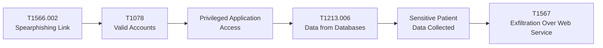
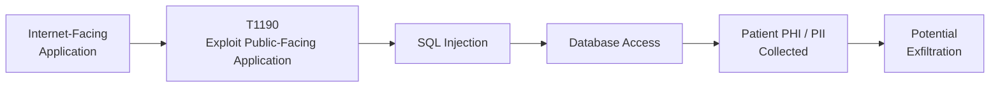
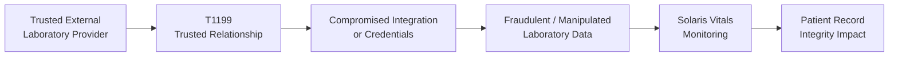

# MITRE ATT&CK Mapping – Solaris Care Connect 360

## Overview

This document maps key threats identified in the Solaris Care Connect 360 STRIDE threat register to relevant **MITRE ATT&CK tactics and techniques**.

MITRE ATT&CK provides a behavioural view of how adversaries may carry out attacks against the platform.

The mapping complements the other threat-modelling methods used in this project:

- **STRIDE** identifies what can go wrong.
- **MITRE ATT&CK** describes how an attacker may perform the attack.
- **Cyber Kill Chain** shows how an attack may progress.
- **Risk scoring** determines which threats require the highest remediation priority.

> MITRE ATT&CK does not provide a direct technique for every application-security weakness. Where a threat such as IDOR is represented, the mapping refers to the closest relevant adversary behaviour rather than treating the vulnerability itself as an ATT&CK technique.

---

# Threat-to-Technique Mapping

| STRIDE ID | Threat | MITRE ATT&CK Technique | Technique ID | Tactic | Primary Mitigation |
|---|---|---|---|---|---|
| **S1** | Credential Phishing | Phishing: Spearphishing Link | **T1566.002** | Initial Access | MFA, email filtering, security awareness training |
| **S2** | Fake Doctor Accounts | Create Account | **T1136** | Persistence | Account approval, account monitoring, MFA |
| **S3** | Stolen Access Token | Steal Application Access Token | **T1528** | Credential Access | Token validation, secure token storage, short expiry |
| **S4** | MITM on Insurance Integration | Adversary-in-the-Middle | **T1557** | Credential Access / Collection | Mutual TLS, certificate validation, encrypted communications |
| **S5** | Compromised / Spoofed Laboratory Integration | Trusted Relationship | **T1199** | Initial Access | Strong API authentication, mutual TLS, message integrity validation, third-party access controls |
| **T3** | Audit Log Tampering | Indicator Removal | **T1070** | Defense Evasion | Centralised tamper-resistant logging |
| **I1** | SQL Injection Data Breach | Exploit Public-Facing Application | **T1190** | Initial Access | Input validation, prepared statements, WAF |
| **I5** | Exposed Backup Data | Data from Information Repositories | **T1213** | Collection | Secure backup permissions, encryption, access monitoring |
| **E1** | Patient-to-Doctor Privilege Escalation | Valid Accounts | **T1078** | Privilege Escalation | RBAC, least privilege, access reviews |
| **E2** | Doctor-to-Administrator Escalation | Account Manipulation | **T1098** | Persistence / Privilege Escalation | PAM, role-change monitoring |
| **E3** | SQL Injection to DBA | Exploit Public-Facing Application | **T1190** | Initial Access | Database hardening, least privilege, WAF |
| **E4** | Container Escape | Escape to Host | **T1611** | Privilege Escalation | Container hardening, runtime controls |
| **E5** | IDOR / Cross-Patient Access | Valid Accounts (contextual) | **T1078** | Privilege Escalation / Defense Evasion | Object-level authorisation, RBAC, access monitoring |

---

# Key Attack Techniques

## T1566.002 – Phishing: Spearphishing Link

### Application to Solaris

An attacker sends a targeted phishing email containing a malicious link to a patient, doctor or privileged administrator.

The victim may be directed to a fraudulent authentication portal designed to capture valid credentials.

### Associated Threat

**S1 – Credential Phishing**

### Mitigations

- phishing-resistant MFA
- secure email gateway
- URL filtering
- security awareness training
- phishing simulations

---

## T1078 – Valid Accounts

### Application to Solaris

After obtaining legitimate credentials, an attacker may authenticate through normal Solaris Care Connect 360 workflows.

Because the credentials are valid, attacker activity may initially appear legitimate.

### Associated Threats

- **S1 – Credential Phishing**
- **E1 – Patient-to-Doctor Privilege Escalation**
- **E5 – Cross-Patient Record Access**, where a legitimate authenticated account is used to abuse weak authorisation

### Mitigations

- Multi-Factor Authentication
- conditional access
- login anomaly detection
- least privilege
- session monitoring
- object-level authorisation

---

## T1528 – Steal Application Access Token

### Application to Solaris

An attacker who obtains a valid application or session token may impersonate an authenticated user without knowing the user's password.

### Associated Threat

**S3 – Stolen Access Token**

### Mitigations

- secure token storage
- short token lifetime
- token revocation
- secure session management
- TLS
- anomaly detection

---

## T1199 – Trusted Relationship

### Application to Solaris

Solaris Care Connect 360 relies on trusted external healthcare integrations, including laboratory systems.

If a trusted laboratory provider or its credentials were compromised, an attacker could potentially abuse that trusted relationship to submit fraudulent or manipulated information to Solaris.

### Associated Threat

**S5 – Spoofed Laboratory Results**

### Mitigations

- strong API authentication
- mutual TLS
- certificate validation
- message integrity validation
- third-party access controls
- integration monitoring
- validation of incoming laboratory data

> T1199 applies where the attacker compromises or abuses the trusted third-party relationship. It does not imply that every malformed or fraudulent laboratory message automatically represents this ATT&CK technique.

---

## T1557 – Adversary-in-the-Middle

### Application to Solaris

An attacker may attempt to position themselves between Solaris and an external integration such as an insurance provider.

This could enable interception or manipulation of network communications.

### Associated Threat

**S4 – MITM on Insurance Integration**

### Mitigations

- TLS
- mutual TLS where appropriate
- strong certificate validation
- secure DNS
- network monitoring
- authenticated API communication

---

## T1190 – Exploit Public-Facing Application

### Application to Solaris

Internet-facing components such as the API Gateway or Patient Records functionality may be targeted through application vulnerabilities.

A successful SQL injection vulnerability could allow access to sensitive patient information.

### Associated Threats

- **I1 – SQL Injection Data Breach**
- **E3 – SQL Injection to DBA**

### Mitigations

- parameterised SQL queries
- server-side input validation
- Web Application Firewall
- vulnerability scanning
- secure coding practices
- patch management
- least-privilege database accounts

---

## T1098 – Account Manipulation

### Application to Solaris

An attacker with sufficient privileges may alter account roles, permissions or authentication settings to maintain or expand access.

### Associated Threat

**E2 – Doctor-to-Administrator Escalation**

### Mitigations

- Role-Based Access Control
- Privileged Access Management
- separation of duties
- monitoring of role changes
- approval workflows

---

## T1136 – Create Account

### Application to Solaris

An attacker with sufficient administrative access may create an unauthorised doctor or administrator account to establish persistent access.

### Associated Threat

**S2 – Fake Doctor Accounts**

### Mitigations

- account-creation approval
- MFA
- identity verification
- monitoring of new privileged accounts
- regular account reviews

---

## T1070 – Indicator Removal

### Application to Solaris

An attacker who gains sufficient access may attempt to delete or manipulate security evidence to make malicious activity more difficult to detect or investigate.

This could include attempts to remove or modify:

- application logs
- authentication records
- database audit information
- administrative activity records

### Associated Threat

**T3 – Audit Log Tampering**

### Mitigations

- centralised logging
- tamper-resistant audit storage
- restricted permissions on security logs
- SIEM ingestion
- alerts for deletion or modification of audit records

---

## T1213 – Data from Information Repositories

### Application to Solaris

An attacker who gains access to repositories containing sensitive information may collect data for further exploitation or exfiltration.

In Solaris, sensitive repositories may contain:

- patient records
- healthcare documents
- database information
- backup data

### Associated Threat

**I5 – Exposed Backup Data**

### Mitigations

- strong access controls
- encryption at rest
- secure backup permissions
- access monitoring
- least privilege
- audit logging

---

## T1611 – Escape to Host

### Application to Solaris

If Solaris backend services are deployed in containers, an attacker who compromises a container may attempt to escape into the underlying host.

### Associated Threat

**E4 – Container Escape**

### Mitigations

- run containers as non-root
- minimise Linux capabilities
- use seccomp or AppArmor profiles
- patch container runtimes
- runtime monitoring
- avoid privileged containers

> The applicability of this technique depends on the final Solaris deployment architecture.

---

# Example Healthcare Data-Breach Attack Chain



This represents one possible attack chain in which:

1. a user is targeted through phishing
2. legitimate credentials are compromised
3. the attacker authenticates using a valid account
4. healthcare information is accessed
5. patient data is collected from the database
6. the data is potentially exfiltrated through an external web service

> T1567 is shown as an example exfiltration technique only where the attacker specifically transfers the collected data using a web service.

---

# SQL Injection Attack Chain



The SQL injection path demonstrates why controls must exist at multiple layers:

**WAF → input validation → parameterised queries → least-privilege database account → database monitoring**

---

# Trusted Integration Attack Path



This attack path highlights the risk created when Solaris places trust in external healthcare providers.

Defensive controls should verify both the **identity of the external system** and the **integrity of the information it submits**.

---

# Recommended Mitigations

| Control | Purpose | Relevant Threats |
|---|---|---|
| **Multi-Factor Authentication** | Reduce effectiveness of stolen credentials | S1, E1 |
| **Security Awareness Training** | Reduce successful phishing | S1 |
| **Web Application Firewall** | Block common malicious application requests | I1, E3 |
| **Prepared Statements** | Prevent SQL injection from altering query structure | I1, E3 |
| **Privileged Access Management** | Restrict and monitor privileged identities | E1, E2 |
| **Least Privilege** | Limit attacker access following compromise | E1, E2, E3 |
| **Mutual TLS / Strong API Authentication** | Protect trusted external integrations | S4, S5 |
| **Network Segmentation** | Restrict movement between trust zones | E3, E4 |
| **Data Loss Prevention** | Detect or restrict unauthorised sensitive-data movement | I1, I5 |
| **Centralised Logging / SIEM** | Detect suspicious authentication and data access | S1, S3, T3, E1 |
| **Patch Management** | Reduce exposure to known application and infrastructure vulnerabilities | I1, E4 |

---

# Detection Opportunities

| ATT&CK Behaviour | Detection Opportunity |
|---|---|
| Phishing delivery | Email gateway and URL inspection |
| Use of stolen credentials | Authentication anomaly detection |
| Stolen access-token use | Session and identity monitoring |
| New privileged account | Identity-management alerts |
| Role or permission changes | Privileged-access monitoring |
| SQL injection attempts | WAF and application logs |
| Abnormal database queries | Database Activity Monitoring |
| Manipulation of audit evidence | SIEM alerts and tamper-resistant logging |
| Suspicious external integration activity | API gateway and integration monitoring |
| Large patient-record access | SIEM / behavioural analytics |
| Large outbound data transfer | DLP / network monitoring |
| Container escape behaviour | Runtime security monitoring |

---

# Relationship to STRIDE

The MITRE ATT&CK mapping builds on threats identified in the STRIDE register.

For example:

```text
S1 Credential Phishing
        ↓
T1566.002 Spearphishing Link
        ↓
T1078 Valid Accounts
        ↓
Patient Data Access
```

and:

```text
I1 SQL Injection
        ↓
T1190 Exploit Public-Facing Application
        ↓
Database Compromise
        ↓
PHI / PII Disclosure
```

and:

```text
S5 Spoofed Laboratory Results
        ↓
T1199 Trusted Relationship
        ↓
Compromised External Integration
        ↓
Manipulated Healthcare Data
```

This creates a traceable relationship between:

**system threat → attacker behaviour → security control**

---

# Key Findings

Three attack areas require particularly strong defensive coverage.

## Identity-Based Attack

**Phishing → stolen credentials → valid account → privileged access → patient-data access**

Primary controls:

- MFA
- security awareness
- RBAC
- PAM
- anomaly detection

---

## Application-Based Attack

**Internet-facing application → SQL injection → database access → PHI/PII exposure**

Primary controls:

- WAF
- input validation
- parameterised queries
- database least privilege
- Database Activity Monitoring

---

## Trusted Integration Attack

**Compromised third party → trusted relationship → manipulated inbound data → healthcare-data integrity impact**

Primary controls:

- strong API authentication
- mutual TLS
- message integrity validation
- third-party access controls
- integration monitoring

---

## Conclusion

MITRE ATT&CK provides a behavioural view of how threats identified through STRIDE may be realised by an adversary.

The mapping demonstrates that Solaris Care Connect 360 must defend against multiple attack routes involving:

- compromised identities
- application vulnerabilities
- privilege abuse
- external trust relationships
- access to sensitive information repositories

MITRE ATT&CK mappings should be reviewed whenever the system architecture or identified attack scenarios change.

---

## Related Documentation

- [STRIDE Threat Register](./stride-threats.md)
- [Cyber Kill Chain Analysis](./kill-chain-analysis.md)
- [Risk Register](./risk-register.md)
- [Security Control Mapping](./control-mapping.md)
- [System Architecture](../diagrams/architecture.md)
- [Data Flow Diagrams](../diagrams/dfd-level1.md)
- [Scenario 1 MITRE ATT&CK Analysis](../Scenario%201/MITRE%20ATT%26CK%20Sequence%20Summary.md)
