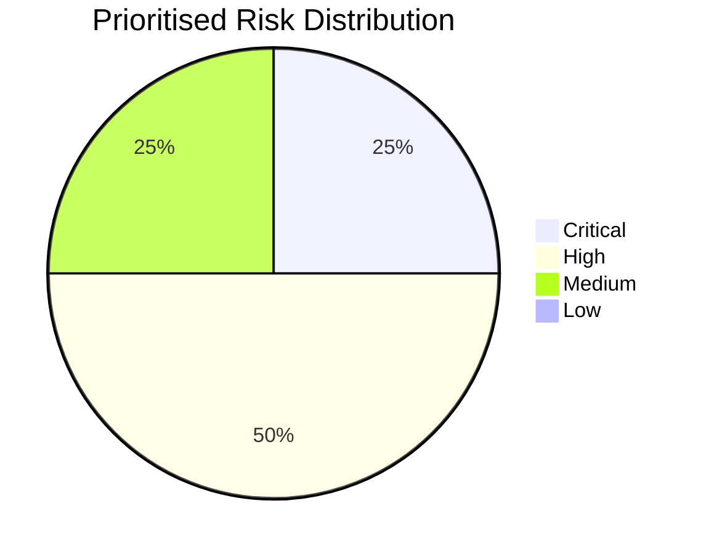
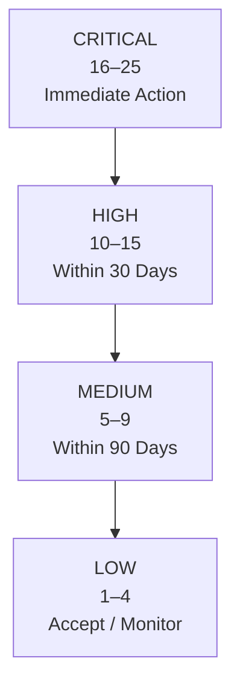

# Risk Register – Solaris Care Connect 360

## Overview

This risk register prioritises key threats identified during the STRIDE assessment of Solaris Care Connect 360.

Each threat is assessed using a **Likelihood × Impact** methodology.

The purpose of the assessment is to identify which threats require immediate remediation and which can be addressed over a longer timeframe.

---

# Risk Scoring Methodology

## Risk Formula

**Risk Score = Likelihood × Impact**

Both Likelihood and Impact are scored from **1 to 5**, producing a maximum risk score of **25**.

---

## Likelihood Scale

| Score | Rating | Description |
|---:|---|---|
| **1** | Rare | Unlikely to occur |
| **2** | Unlikely | Could occur occasionally |
| **3** | Possible | Could occur under realistic circumstances |
| **4** | Likely | Expected to occur or has a credible attack path |
| **5** | Almost Certain | Expected to occur frequently or with minimal attacker effort |

---

## Impact Scale

| Score | Rating | Description |
|---:|---|---|
| **1** | Negligible | Minimal effect on systems or users |
| **2** | Minor | Limited impact with straightforward recovery |
| **3** | Moderate | Significant but manageable operational or security impact |
| **4** | Major | Serious data exposure, operational disruption or security compromise |
| **5** | Severe | Potentially catastrophic impact involving large-scale PHI exposure, patient safety or major business disruption |

---

# Risk Severity Thresholds

| Risk Score | Priority | Required Response |
|---:|---|---|
| **16–25** | 🔴 Critical | Immediate remediation required |
| **10–15** | 🟠 High | Address within 30 days |
| **5–9** | 🟡 Medium | Address within 90 days |
| **1–4** | 🟢 Low | Accept, monitor or address when appropriate |

---

# Risk Matrix

| Likelihood ↓ / Impact → | **1 – Negligible** | **2 – Minor** | **3 – Moderate** | **4 – Major** | **5 – Severe** |
|---|---:|---:|---:|---:|---:|
| **5 – Almost Certain** | 5 Medium | 10 High | 15 High | 20 Critical | 25 Critical |
| **4 – Likely** | 4 Low | 8 Medium | 12 High | 16 Critical | 20 Critical |
| **3 – Possible** | 3 Low | 6 Medium | 9 Medium | 12 High | 15 High |
| **2 – Unlikely** | 2 Low | 4 Low | 6 Medium | 8 Medium | 10 High |
| **1 – Rare** | 1 Low | 2 Low | 3 Low | 4 Low | 5 Medium |

---

# Scored Threat Register

| ID | Threat | STRIDE Category | Likelihood | Impact | Risk Score | Priority |
|---|---|---|---:|---:|---:|---|
| **I1** | SQL Injection – Patient Data Breach | Information Disclosure | **4** | **5** | **20** | 🔴 **Critical** |
| **S1** | Credential Phishing | Spoofing | **4** | **4** | **16** | 🔴 **Critical** |
| **E3** | SQL Injection to Database Administrator Access | Elevation of Privilege | **3** | **5** | **15** | 🟠 **High** |
| **I2** | Excessive Data Returned by API | Information Disclosure | **4** | **3** | **12** | 🟠 **High** |
| **E1** | Patient-to-Doctor Privilege Escalation | Elevation of Privilege | **3** | **4** | **12** | 🟠 **High** |
| **T2** | Prescription Tampering | Tampering | **2** | **5** | **10** | 🟠 **High** |
| **D1** | DDoS Attack Against API Gateway | Denial of Service | **3** | **3** | **9** | 🟡 **Medium** |
| **R1** | Prescription Approval Repudiation | Repudiation | **2** | **3** | **6** | 🟡 **Medium** |

---

# Risk Distribution

| Severity | Count |
|---|---:|
| 🔴 **Critical** | **2** |
| 🟠 **High** | **4** |
| 🟡 **Medium** | **2** |
| 🟢 **Low** | **0** |
| **Total** | **8** |



---

# Top 5 Risks

## 1. I1 – SQL Injection Data Breach

**Likelihood:** 4 – Likely  
**Impact:** 5 – Severe  
**Risk Score:** **20/25 – Critical**

### Risk

An attacker exploits a SQL injection vulnerability within an internet-facing Solaris application or API and retrieves sensitive patient information from the PostgreSQL database.

### Potential Impact

- large-scale PHI/PII disclosure
- compromise of patient privacy
- regulatory consequences
- reputational damage
- potential access to approximately 50,000 patient records

### Priority Controls

- parameterised queries / prepared statements
- server-side input validation
- Web Application Firewall
- least-privilege database accounts
- Database Activity Monitoring
- application security testing

---

## 2. S1 – Credential Phishing

**Likelihood:** 4 – Likely  
**Impact:** 4 – Major  
**Risk Score:** **16/25 – Critical**

### Risk

An attacker uses phishing to obtain valid Solaris credentials and impersonates a legitimate patient, doctor or privileged administrator.

### Potential Impact

- account takeover
- unauthorised access to PHI
- abuse of privileged functionality
- further privilege escalation
- patient-data disclosure

### Priority Controls

- phishing-resistant MFA
- secure email filtering
- security awareness training
- login anomaly detection
- conditional access
- rapid session revocation

---

## 3. E3 – SQL Injection to Database Administrator Access

**Likelihood:** 3 – Possible  
**Impact:** 5 – Severe  
**Risk Score:** **15/25 – High**

### Risk

A SQL injection vulnerability provides an attacker with excessive database privileges or enables escalation towards database-administrator access.

### Potential Impact

- unrestricted database access
- patient-data theft
- modification or deletion of clinical information
- database service disruption

### Priority Controls

- least-privilege database service accounts
- prepared statements
- database hardening
- WAF
- database activity monitoring
- privileged-access monitoring

---

## 4. I2 – Excessive Data Return

**Likelihood:** 4 – Likely  
**Impact:** 3 – Moderate  
**Risk Score:** **12/25 – High**

### Risk

An API endpoint returns more patient or healthcare information than is required for the legitimate request.

### Potential Impact

- unnecessary PHI/PII exposure
- increased impact of compromised user accounts
- privacy violations
- easier data harvesting

### Priority Controls

- data minimisation
- API response filtering
- object-level authorisation
- RBAC
- API security testing

---

## 5. E1 – Patient-to-Doctor Privilege Escalation

**Likelihood:** 3 – Possible  
**Impact:** 4 – Major  
**Risk Score:** **12/25 – High**

### Risk

A patient account gains access to functionality or permissions intended for healthcare professionals.

### Potential Impact

- unauthorised patient-record access
- access to clinical functions
- potential modification of healthcare information
- wider PHI exposure

### Priority Controls

- RBAC
- server-side authorisation
- least privilege
- role-change monitoring
- access-control testing

---

# Remaining Prioritised Risks

## T2 – Prescription Tampering

**Score:** **10/25 – High**

Unauthorised modification of medication or dosage information could affect the integrity of clinical information and potentially patient safety.

Primary controls include:

- strong authorisation
- integrity validation
- audit logging
- approval workflows
- monitoring of prescription changes

---

## D1 – DDoS Attack

**Score:** **9/25 – Medium**

A distributed denial-of-service attack against the API Gateway could prevent patients and healthcare professionals from accessing Solaris services.

Primary controls include:

- DDoS protection
- rate limiting
- autoscaling
- traffic monitoring
- resilient service architecture

---

## R1 – Prescription Approval Repudiation

**Score:** **6/25 – Medium**

A doctor may dispute having approved a prescription if sufficient audit evidence is unavailable.

Primary controls include:

- authenticated actions
- tamper-resistant audit logs
- timestamps
- user/session correlation
- centralised logging

---

# Remediation Priority



---

# Prioritised Remediation Plan

| Priority | Risk IDs | Primary Actions |
|---|---|---|
| **Immediate** | I1, S1 | Deploy SQL injection protections and strengthen authentication with MFA |
| **0–30 Days** | E3, I2, E1, T2 | Harden database privileges, improve API authorisation, review RBAC and protect prescription integrity |
| **30–90 Days** | D1, R1 | Improve availability protections and strengthen audit evidence |

---

# Risk Treatment Principles

The following treatment approach should be used:

### Critical Risks

Implement preventative controls immediately and ensure corresponding detective controls are available.

### High Risks

Prioritise remediation after Critical risks and track implementation through a defined remediation plan.

### Medium Risks

Address through planned security improvements and continue monitoring for changes in likelihood or impact.

### Low Risks

Monitor or formally accept where remediation cost exceeds the expected security benefit.

---

# Residual Risk

The scores in this document represent the **inherent risk before the effectiveness of proposed remediation controls is fully considered**.

Following implementation of security controls, each risk should be reassessed to determine its **residual risk**.

For example:

```text
Inherent Risk
      ↓
Security Controls Implemented
      ↓
Control Effectiveness Validated
      ↓
Residual Risk Reassessed
```

Risk should only be considered reduced after the relevant control has been implemented and its effectiveness verified.

---

## Related Documentation

- [STRIDE Threat Register](./stride-threats.md)
- [MITRE ATT&CK Mapping](./mitre-mapping.md)
- [Cyber Kill Chain Analysis](./kill-chain-analysis.md)
- [System Architecture](../HLD.md)
- [Data Flow Diagrams](../Data%20Flow%20Diagram.md)
